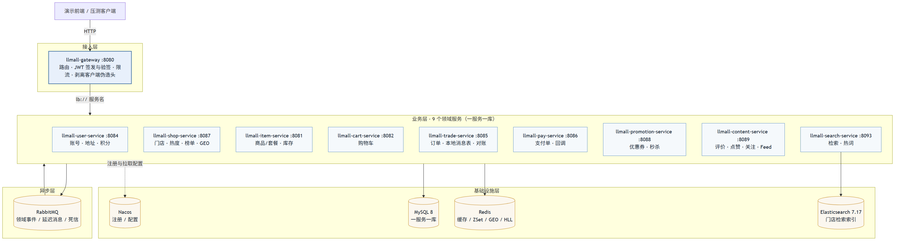
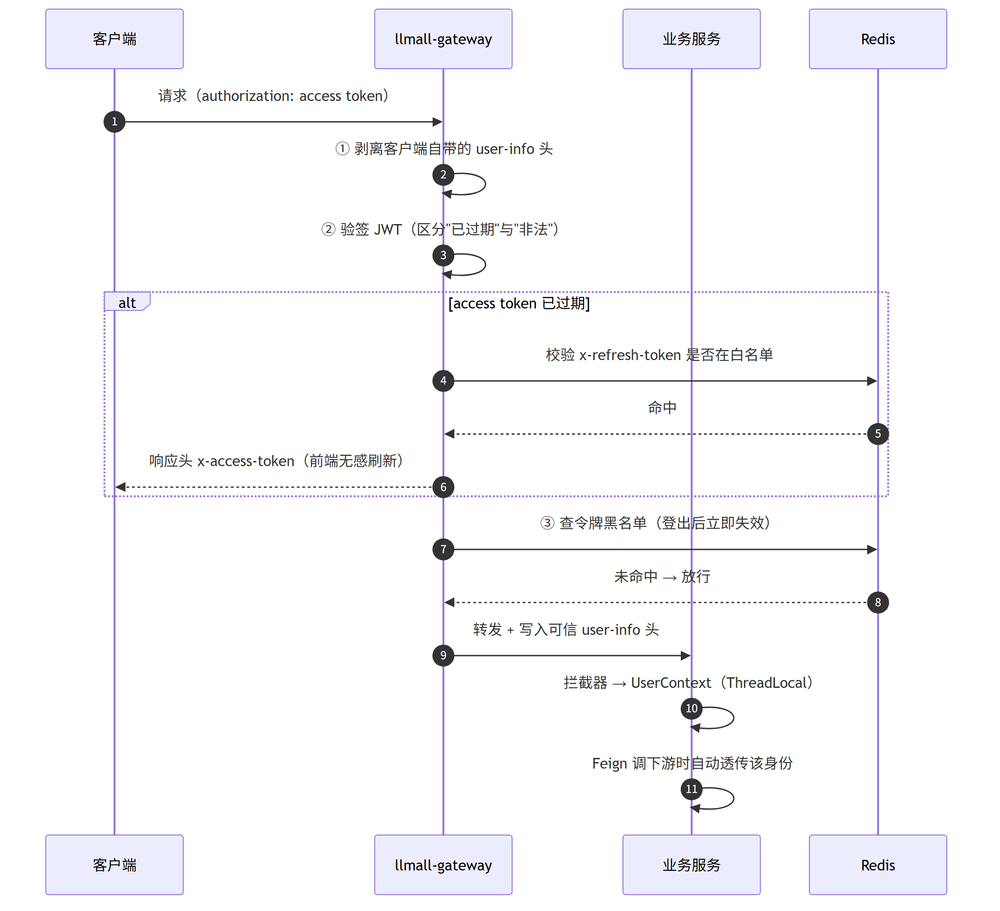
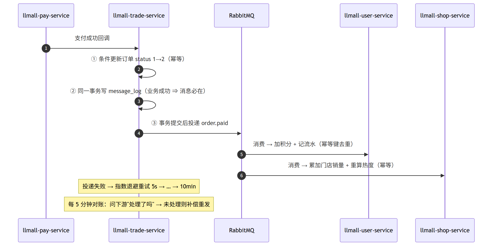
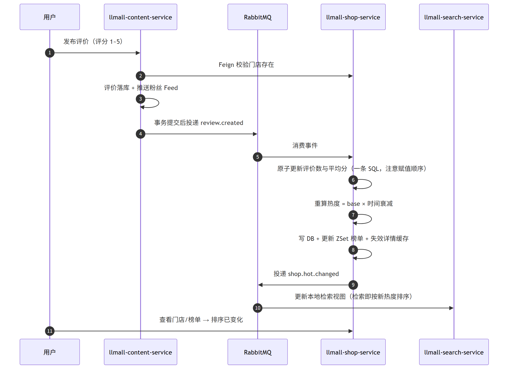
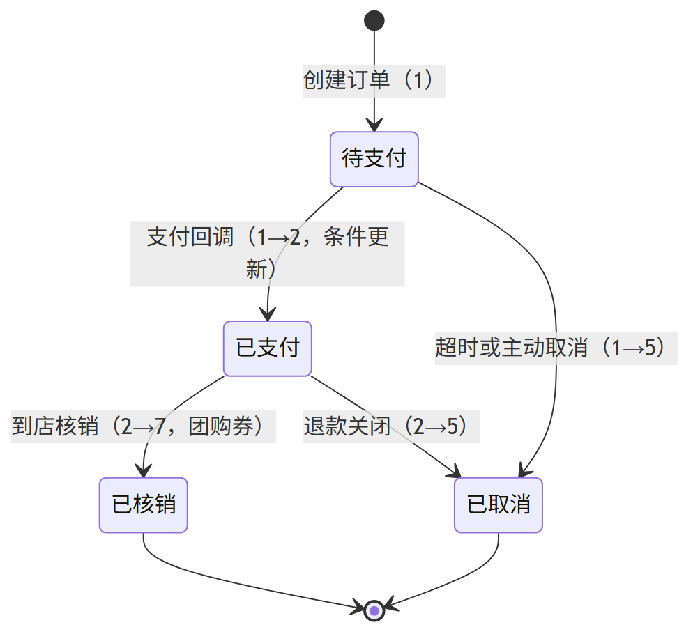
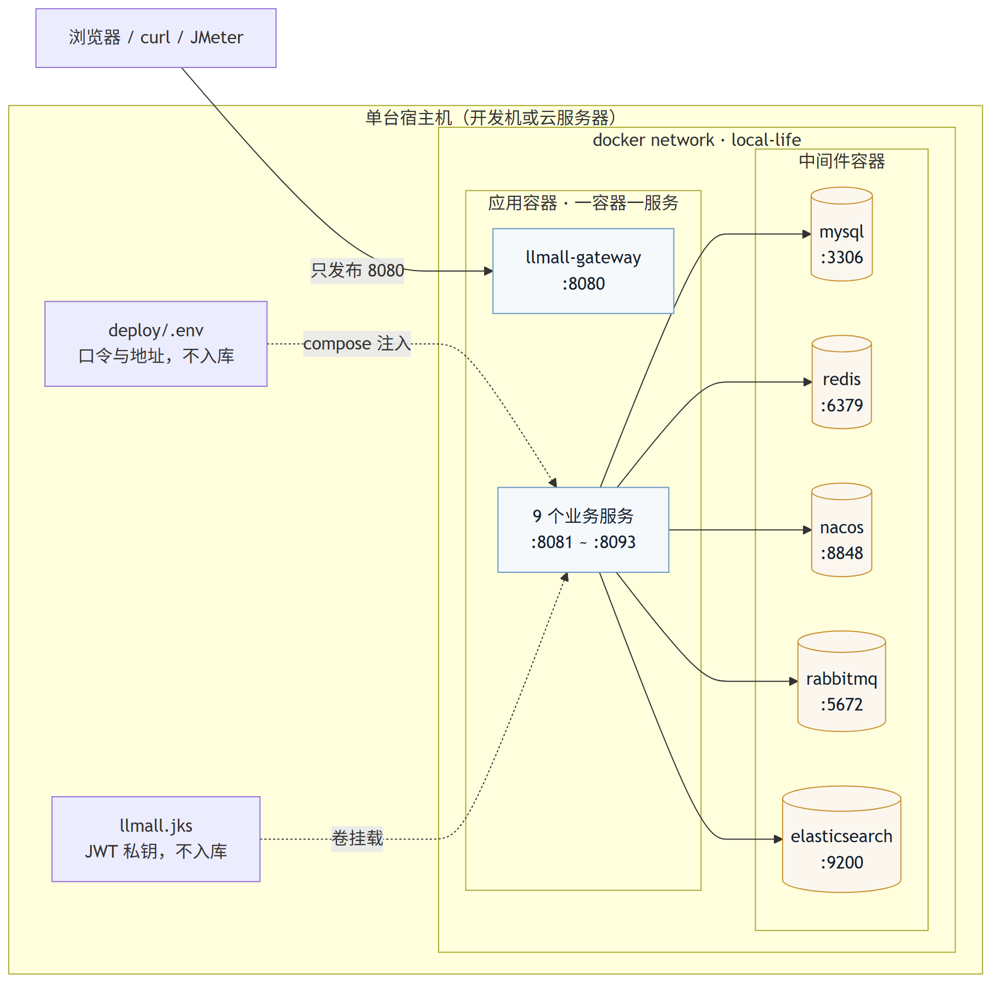
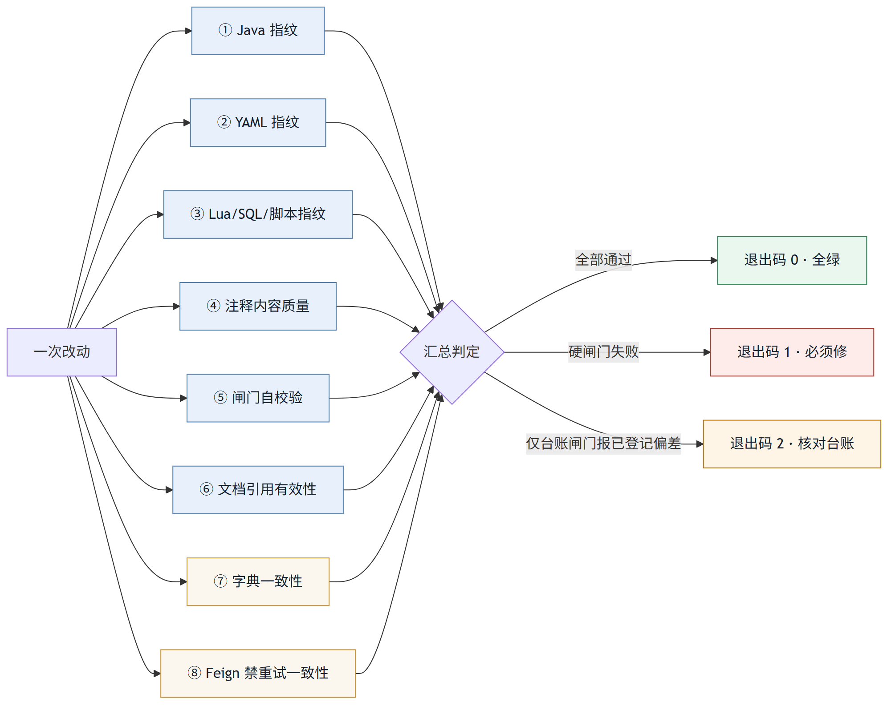

# 同城生活电商平台 · llmall

> **一句话**：**10 个服务、一服务一库**的同城生活电商后端（1 个网关 + 9 个业务域），跑通
> 「逛门店 → 买套餐 → 下单支付 → 到店核销 → 写评价 → 门店热度/榜单」的完整闭环。
>
> 亮点不在于"写完了"，而在于**每条结论都带可复现的机器判据**：八道工程闸门、端到端 37 项断言、
> 压测 + 账实核对。


**三条一眼能看懂的数字**（口径与原始数据见 [§6 实测数据](#6-实测数据)、`benchmark/README.md`、`docs/P-01`~`P-03`）

| 维度 | 结果 |
|---|---|
| **资金安全** | 50 并发完成 **1,500 次完整闭环**（下单 / 支付单 / 支付各 1,500 次，错误率 0%）：余额减少 **38,400,000 分 = 25,600 × 1500.0**，一单一张支付单；并发双击只扣一次（口径见 `benchmark/README.md` §4「零截断闭环轮」） |
| **读路径性能** | Feed 收件箱 100 并发 P99 **92 ms**（v1）/ **117 ms**（v2 推拉）、每请求 SQL 条数恒定（v1 **2.0**、v2 **4.0** 起，上界 6.0）、错误率 **0%**；ES 检索 P99 **47 ms** |
| **工程化** | **八道闸门 + 三态退出码 + 39 行台账**；端到端冒烟 **37 项通过 / 0 失败**；改一行配置也会被闸门精确点名 |

**目录**：[系统全景](#1-系统全景) · [核心链路](#2-核心链路) · [部署形态](#3-部署形态) ·
[快速开始](#4-快速开始) · [工程治理](#5-工程治理八道闸门) · [实测数据](#6-实测数据) ·
[选型取舍](#7-技术选型与取舍) · [目录结构](#8-目录结构) · [文档导航](#9-文档导航) ·
[安全须知](#10-安全须知) · [路线图](#11-路线图)

---

## 1. 系统全景

### 1.1 分层架构

客户端只认网关；业务服务之间只经 `llmall-api` 的 Feign 契约调用；跨域的写扩散一律走 MQ 事件，
不在同一次请求里串起来。



### 1.2 服务与数据归属

「一个服务 = 一个业务能力 + 独占数据 + 可独立演进」，没有跨库 JOIN，也没有共享表。

| 服务 | 端口 | 独占库 | 职责 |
|---|---|---|---|
| llmall-gateway | 8080 | — | 路由、JWT 签发/验签、限流、剥离伪造用户头 |
| llmall-user-service | 8084 | llmall-user | 账号（密码/验证码双通道）、地址、积分与流水、签到 |
| llmall-shop-service | 8087 | llmall-shop | 门店/类型、缓存三件套、热度分、ZSet 榜单、GEO、UV |
| llmall-item-service | 8081 | llmall-item | 商品/套餐、库存扣减与流水、门店套餐查询 |
| llmall-cart-service | 8082 | llmall-cart | 购物车 |
| llmall-trade-service | 8085 | llmall-trade | 订单（实物/团购券）、本地消息表、重试与对账 |
| llmall-pay-service | 8086 | llmall-pay | 支付单与回调 |
| llmall-promotion-service | 8088 | llmall-promotion | 优惠券发放/领取/核销、秒杀券（Lua 原子预扣减 + 一人一单 + MQ 异步落库） |
| llmall-content-service | 8089 | llmall-content | 评价/笔记、评论、点赞、关注、Feed |
| llmall-search-service | 8093 | llmall-search | 门店检索（ES 与 MySQL 读模型双引擎，`engine=auto` 优先 ES、不可用时自动回落）、热词与建议、搜索历史 |

> **端口口径**：上表是本项目**唯一**的端口来源，其余文档一律引用这里。
> **8090 预留给 Sentinel 控制台**——注意其默认端口是 8080、会与网关冲突，启动时必须显式
> `-Dserver.port=8090`（见 [`deploy/部署说明.md`](deploy/部署说明.md)）。

---

## 2. 核心链路

### 2.1 统一鉴权与身份透传（含防伪造加固）

鉴权只在网关做一次；下游靠**可信请求头 + ThreadLocal**，Feign 调用自动透传。



**这一条修复过的真问题**：免鉴权路径曾可直接伪造 `user-info` 冒充任意用户（越权）。
现在的做法是**入口无条件剥离**客户端提供的身份头，只信任网关写入的那一份。

### 2.2 下单 → 支付 → 积分/销量（跨域最终一致性）

业务成功 ⇒ 消息必在：消息表与业务数据**同一个本地事务**提交，投递失败靠重试与对账补齐。



**三层幂等**：生产（`message_log` 唯一键）、消费（消费记录唯一键）、业务（业务唯一键），
绝不假设 MQ 不重复。

### 2.3 评价 → 门店热度 → 榜单排序（准实时闭环）

门店排序从 T+1 批处理改成**事件驱动的秒级更新**：写路径一条 SQL 原子更新，读路径只读 ZSet。



### 2.4 订单状态机

状态迁移全部靠**条件更新**（`WHERE status = 期望旧值`）实现，并发下只有一个请求能迁移成功。



> 字典口径：`1 待支付` / `2 已支付（待发货或待核销）` / `5 已取消` / `7 已核销`，
> 与 `Order.STATUS_*` 逐值一致（由闸门 7「字典一致性」持续校验）。

---

## 3. 部署形态

应用与中间件跑在同一个 Docker 网络上，容器间按容器名互访；对外只发布网关端口。



| 形态 | 适用场景 | 编排文件 |
|---|---|---|
| **本地中间件 + IDEA 跑服务** | 日常开发、单点调试 | `docker/docker-compose-infra-lite.yml` |
| **全量容器化** | 演示环境、云服务器 | `deploy/docker-compose-apps.yml`（`core` / `full` 两个 profile） |
| **复用外部 ES** | 本机已装 Elasticsearch + IK | 不启动 `addon`，用 `-ExternalEs` 指向现有实例 |

完整步骤、内存口径、时区口径与排障表见 **[`deploy/部署说明.md`](deploy/部署说明.md)**。

---

## 4. 快速开始

### 4.1 三条命令跑通（推荐）

```powershell
pwsh -File demo.ps1 -Reset     # 停容器 + 删卷 + 删网络（幂等）
pwsh -File demo.ps1            # 建中间件 → 建库灌数 → 导 Nacos → 灌 ES → 起服务 → 冒烟
pwsh -File demo.ps1 -Down      # 收尾（加 -Volumes 连数据卷一起删）
```

`demo.ps1` 只**编排仓库里既有的材料**，不重造任何东西：`mvn package` + `deploy/Dockerfile` 构建单镜像 →
`docker/docker-compose-infra-lite.yml` + `docker/docker-compose-addon.yml` 的 `elasticsearch` 起中间件 →
按 `sql/merged/README.md` 的顺序建库灌数（**52 冻结不执行**，执行前先跑 `52a` 只读清点并要求 verdict = 0）→
Nacos Open API 导入 `nacos-config/*.yaml` 与 `gateway-routes.json` → `gates/EsBulkLoad.java` + `es-shop-mapping.json` 灌 ES →
`deploy/docker-compose-apps.yml --profile full` 起应用 → `scripts/MallE2E.java` 冒烟
（结果写进 `logs/demo/demo-report-*.md`，含 `docker stats` 峰值内存）。

前置：**Docker**（缺失时脚本在预检阶段退出码 2 并给出提示）、JDK 11 与 Maven（`-SkipBuild` 可复用已有镜像）。
只有 Windows PowerShell 5.1 的机器同样可用。`--profile` 默认 `full` 而不是 `core`：冒烟链路要
trade/cart/pay/promotion/search，`core` 起不全必然红。

### 4.2 手工起（IDEA + 本机中间件）

```bash
# 1) 中间件（低内存版：MySQL + Redis + Nacos + RabbitMQ，约 1.6G）
docker network create local-life
docker compose -f docker/docker-compose-infra-lite.yml up -d

# 2) 建库建表：按 sql/merged/README.md 的顺序导入
# 3) 导入 Nacos 共享配置：见 nacos-config/README.md
# 4) 启动服务（按链路最小集启动，不要一次全起）
#    建议 JVM 参数：-Xms64m -Xmx192m -XX:MaxMetaspaceSize=128m -XX:+UseSerialGC -XX:TieredStopAtLevel=1

# 5) 生成 JWT 私钥（首次 clone 必须做，否则网关与用户服务起不来）
pwsh -File scripts/gen-jks.ps1

# 6) 验证
curl http://localhost:8080/shops/1
pwsh -File scripts/verify-auth.ps1          # 鉴权链路端到端验收
```

### 4.3 演示前端

`frontend/index.html` 是单文件、零依赖的演示台，双击即可打开（需后端已起），覆盖门店热度榜、
发布评价后榜单实时变化、登录与积分流水。详见 [`frontend/README.md`](frontend/README.md)。

---

## 5. 工程治理：八道闸门

「只改注释、代码零改动」这句话在本仓库里不是承诺，而是**可复现的机器判据**。
闸门工具集、现行基线与自校验依赖都随仓库交付（`gates/`），clone 下来就能复现。



**一条运行命令**（仓库根目录）：

```powershell
pwsh -File gates\verify-all.ps1            # 八道闸门 + 全量编译；-SkipBuild 只跑分析闸门
```

只有 Windows PowerShell 5.1 的机器同样可用：`powershell -ExecutionPolicy Bypass -File gates\verify-all.ps1 -SkipBuild`
（闸门不要求 `PATH` 上有 `pwsh`——谁跑起闸门，子脚本就用同一个宿主跑；两种宿主下结论与退出码一致）。

**八道闸门各拦什么**

| # | 闸门 | 拦什么 | 判据 | 类别 |
|---|---|---|---|---|
| 1 | Java 指纹 | 代码语义或**书写形态**被改 | FP1（token 流）= 0 且 FP2（代码行序列）= 0，且无「未被基线覆盖」的文件 | 硬 |
| 2 | YAML 指纹 | 配置项、缩进、结构被改 | 同上 | 硬 |
| 3 | Lua / SQL / 脚本指纹 | 非 Java/YAML 文件的代码被改 | 剥注释后代码行序列 SHA256 逐文件一致 | 硬 |
| 4 | 内容质量 | 11 类不该出现在注释里的东西 | HTML 标签 / 粗体 / 装饰横幅 / 历史叙述 / 实测叙述 / 口语化 / 待办标记 / 审计标签 / 迁移叙述 / 变更叙述 / 模板残留 = 全 0 | 硬 |
| 5 | 闸门自校验 | 闸门**自己**出错 | 34 个用例全过（剥离规则、内容规则、端到端指纹、Feign 重试的运行时对照） | 硬 |
| 6 | 文档引用 | 文档里的 `文件:行` 指不到东西 | 文件在库 + 行号不越界 + 该处非空 + 与成文时逐行一致（区间另判整块迁移）；判不了的单独计数披露 | 硬（失效为硬失败；仅行号漂移时按台账通道记 2） |
| 7 | 字典一致性 | DDL 的取值与代码对不上 | 取值冲突 = 0、库名指向错误 = 0、同表同列表述不一 = 0 | 台账 |
| 8 | Feign 一致性 | 有写调用的服务漏配禁重试 | 用到写方法的服务必须显式引入 `NoRetryFeignConfig` | 台账 |

**三态退出码**（刻意分开，避免把「闸门失效」和「已登记偏差」混为一谈）

| 退出码 | 含义 | 该怎么办 |
|---|---|---|
| `0` | 全绿 | — |
| `1` | **硬闸门失败** —— 闸门失效，或出现未登记的违规 | **必须修**，不得继续 |
| `2` | 硬闸门全过，台账闸门报出**已登记**的待处理偏差 | 逐条核对 [`docs/已知偏差台账-2026-10-15.md`](docs/已知偏差台账-2026-10-15.md) |

**当前真实输出**（pwsh 7.6.6 + JDK 11，最近一次执行）

```text
运行环境
  仓库根      : <本地仓库路径>
  JDK         : OpenJDK 11.0.32.1 LTS
  PowerShell  : 7.6.6 (Core)
  Maven       : Apache Maven 3.9.6

【1/8】Java 去注释指纹（298 文件）      FP1 代码语义变更 : 0   FP2 代码格式变更 : 0   结论: 通过
【2/8】YAML 去注释指纹（42 文件）       FP1 配置内容变更 : 0   FP2 配置格式变更 : 0   结论: 通过
【3/8】Lua / SQL / 脚本指纹             结论: 通过 —— 剥离注释后，代码逐行未变
【4/8】注释内容质量（11 条规则）        扫描文件 : 329   11 条规则全部 0 处   结论: 通过
【5/8】闸门自校验（34 用例）            通过 34 / 失败 0   结论: 全过
【6/8】文档引用有效性                   引用 478 ｜ 通过 474 ｜ 平移 0 ｜ 失效 0 ｜ 跳过 4   结论: 通过
【7/8】字典与跨库引用一致性             ① 取值冲突 0   ② 疑似死状态 6（真候选 2 / 口径误报 4）   ③ 0   ④ 0   结论: 通过
【8/8】Feign 禁重试一致性               6 个客户端；4 个有写调用的服务全部已显式禁用   结论: 通过
【BUILD】全量编译（13 模块）            [INFO] BUILD SUCCESS

闸门汇总：八道分析闸门 + 全量编译全部 PASS，退出码 0 —— 全绿
```

完整判据、基线更新流程与覆盖边界见 [`gates/README.md`](gates/README.md)。

**开发约定：注释规范**

- **规范正文**：[`docs/注释规范.md`](docs/注释规范.md) —— 八类注释（类 / 方法 / 行内 / 风险警示 / 配置 / Lua / SQL / TODO）的写法，以及各模块必须写清的口径（JWT 闭环、库存口径、三态语义、会话水位等）。
- **逐条验收**：[`docs/注释验收清单-2026-10-15.md`](docs/注释验收清单-2026-10-15.md)。
- **改注释必须过闸门**：用去注释指纹证明「只改注释、代码零改动」。

---

## 6. 实测数据

**口径先说清楚**：JMeter 与被测容器跑在同一台宿主机、抢同一批物理核，**QPS 绝对值不可与生产对标**；
可信的是**同环境下的并发梯度对比**。完整环境规格与局限见 [`benchmark/README.md`](benchmark/README.md)。

### 6.1 读路径

| 场景 | 10 并发 | 50 并发 | 100 并发 | 补充 |
|---|---|---|---|---|
| Feed 收件箱 v1 `GET /follows/feed` | P99 9 ms | P99 47 ms | P99 92 ms | 每请求**恒 2.0 条 SQL**（收件箱 1 + 批量笔记 1，与页大小无关）→ 无 N+1；错误率 0% |
| Feed 收件箱 v2 `GET /follows/feed/v2`（推拉） | P99 10 ms | P99 51 ms | P99 117 ms | **4.0 条 SQL**（v1 的两条 + 关注列表 1 + 批数 1），关注 41 个大 V 时 **6.0**；错误率 0% |

> **本轮压测口径**：**精简拓扑**（gateway + content + mysql/redis/nacos/mq，16GB 宿主跑不动全量 10 服务的 60 秒稳态，故精简以保住测量条件）；数据形态：**收件箱 12 条、关注 1 个大 V**（跨阈值场景另有一页 16 条、无重复的实证）；六档均 60 秒稳态、错误率 0%、无熔断，宿主峰值内存 66.7–70.1%。用精简拓扑换测量条件的有效性，比凑一个全量但失真的数字重要。
| 检索 `GET /search`（ES 30 条） | P99 8 ms | P99 25 ms | P99 47 ms | 错误率 0% |
| 商品列表 `GET /items/page` | — | — | 容量 1500~1550 QPS | 限流阈值取实测容量 × 70% = **1000 QPS**；超出即 400（设计内拒绝，不是故障） |

### 6.2 写路径

| 实验 | 结果 |
|---|---|
| 50 并发完成 1,500 次完整闭环 | 下单 / 支付单 / 支付各 1,500 次、错误率 0%；余额减少 38,400,000 分 = 25,600 × 1500.0（一次一扣） |
| 同一支付单 20 线程并发双击 | **1 次成功 + 19 次拒绝**，只扣一次款 |
| 故障注入（消费者停机、重复投递 1000 次） | 零丢单、零重复扣减，恢复后自动补齐 |

### 6.3 强一致 vs 最终一致（做过对照实验）

同一份 JMX 跑 Seata AT on/off 两态：

| 指标 | AT 关闭（默认） | AT 开启 | 变化 |
|---|---|---|---|
| `POST /orders` 平均耗时 | 68.9 ms | 247.7 ms | **+259%** |
| 整链路吞吐 | 73.9 rps | 58.5 rps | **−21%** |
| 账实核对 | 精确成立 | 精确成立 | 两态都成立 |

AT **全链跑通并验证了回滚**（故障注入触发 `Branch Rollbacked result: PhaseTwo_Rollbacked`，
库存 176 →(扣 1)→ 176 不多不少，本地补偿钩子按守卫跳过、**无双回滚**）。
结论：**默认关**，收益只在下单失败回滚时兑现；需要"券与库存不能有中间态"时再开，
且三个 `seata.enabled` 必须同进同退。完整过程见 [`docs/P-03`](docs/P-03-Seata-AT对照-2026-10-17.md)。

> **本机压测上限 ≈ 100 并发**：16GB 宿主跑「10 个业务容器 + 中间件容器 + JMeter」时，
> 100 并发已是可行上限（该档宿主峰值 CPU 到过 94%~100%，再往上会先触发内存 90% 熔断）。
> 更高并发需要更强的机器或远程压测环境——JMX 并发全部由参数传入，换机器只需改 `-Threads`。

---

## 7. 技术选型与取舍

| 决策 | 选择 | 理由 / 代价 |
|---|---|---|
| 服务拆分粒度 | 按**领域**拆 10 个服务 | 一个服务 = 一个业务能力 + 独占数据 + 可独立演进；代价是分布式事务面变大 |
| 鉴权位置 | **只网关验签** | 收敛重复代码、性能好；代价是内网必须可信（配合入口剥离伪造头） |
| JWT 主动失效 | access 黑名单 + refresh 白名单 | 只对需失效部分引入状态，黑名单 TTL = 剩余寿命，不会膨胀 |
| 一致性方案 | **分层，并用对照实验校准过**：强一致用事务框架（Seata AT，可切开关、**默认关**），最终一致用本地消息表 | 实测 AT 让 `POST /orders` +259%、吞吐 −21%，收益只在下单失败回滚时兑现 |
| 缓存击穿 | 逻辑过期 + 互斥锁 + 异步重建 | 牺牲一点实时性，换取"任何时刻都有数据可返回" |
| 榜单存储 | **Redis ZSet**（非 ES） | Top-N 排序毫秒级、极省资源；多条件检索才需要 ES |
| Feed 流 | **推拉结合**：推 = 普通作者（≤1000 粉）发布时写扩散进粉丝收件箱；拉 = 粉丝数 > 1000 的作者**不写扩散**，其粉丝读 v2 时按关注作者分批补拉近 20 条并与收件箱归并去重。端点语义：`/follows/feed`（v1）**冻结为纯推兼容**，`/follows/feed/v2` 才是完整推拉 | 写扩散成本与粉丝数成正比，大 V 侧改读时拉；v2 的代价已量化：吞吐 **−20%~−25%**、P99 **+8%~+27%**、每请求 SQL 2 → 4（1 批）/ 6（3 批上界） |
| 消息可靠性 | 本地消息表 + 重试 + 对账 | 不依赖 MQ 的 confirm 机制，方案自洽、可解释 |
| 幂等 | 三层唯一键 | 生产/消费/业务各一层，绝不假设 MQ 不重复 |
| 打包部署 | 单镜像多 jar | 10 个服务构建一次复用 10 次，省时省盘 |

---

## 8. 目录结构

```text
llmall/
├── llmall-common/            共享库：统一响应、异常、UserContext、鉴权常量、MQ 转换器
├── llmall-api/               服务间契约：Feign 客户端 + DTO + 事件 + 降级
├── llmall-gateway/           网关：鉴权、限流、防伪造
├── llmall-user-service/      用户域
├── llmall-shop-service/      门店域
├── llmall-item-service/      商品域
├── llmall-cart-service/      购物车域
├── llmall-trade-service/     交易域（含本地消息表与对账）
├── llmall-pay-service/       支付域
├── llmall-promotion-service/ 营销域（优惠券 + 秒杀）
├── llmall-content-service/   内容域
├── llmall-search-service/    搜索域（ES + MySQL 读模型双引擎）
├── gates/                    工程化闸门（八道闸门 + 现行基线 + 自校验）
├── docs/                     架构、规范、实测报告、偏差台账（索引见 docs/README.md）
├── deploy/                   Dockerfile / compose / 部署说明
├── docker/                   中间件编排（infra-lite / addon）与 ES-IK 插件
├── nacos-config/             Nacos 共享配置与网关路由
├── sql/                      建库建表与演示数据（合并版见 sql/merged/）
├── benchmark/                JMeter 计划、压测方案与结论
├── scripts/                  验收、密钥生成、Redis 高可用演练等脚本
└── frontend/                 单文件演示前端
```

---

## 9. 文档导航

| 想知道什么 | 看哪里 |
|---|---|
| 系统为什么这么切、这么选 | [`docs/架构设计.md`](docs/架构设计.md) |
| 怎么部署、怎么验收 | [`deploy/部署说明.md`](deploy/部署说明.md) |
| 八道闸门细节与基线更新 | [`gates/README.md`](gates/README.md) |
| 实测数据怎么来的 | [`benchmark/README.md`](benchmark/README.md)、[`docs/P-01`~`P-03`](docs/P-01-申请支付单耗时定位-2026-10-17.md) |
| 还有哪些已知问题 | [`docs/已知偏差台账-2026-10-15.md`](docs/已知偏差台账-2026-10-15.md) |
| 每条结论对应哪段代码 | [`docs/项目亮点索引.md`](docs/项目亮点索引.md) |
| 设计决策的追问与边界 | [`docs/设计决策问答.md`](docs/设计决策问答.md) |
| 全部文档的分类 | [`docs/README.md`](docs/README.md) |

---

## 10. 安全须知

### 10.1 什么不入库

`.gitignore` 保证：`target/`、`logs/`、`.env`、`*.jks`。
其中 `llmall.jks` 是 **JWT 签名私钥**，首次 clone 后须先跑 `scripts/gen-jks.ps1` 生成，
否则网关与用户服务起不来。

### 10.2 凭据如何外置

`compose` 与 `seata` 配置里**没有任何写死的口令**：全部改成 `${VAR:?…}`（缺失即报错退出，
不会静默用默认值把环境起歪）。实际值只放在 **`deploy/.env`**（不入库），仓库里只有带演示值的
`deploy/.env.example`。`demo.ps1` 会自动用示例值生成 `deploy/.env`（并把 Redis/MQ 改成容器名），
所以**一键 demo 依旧是零配置**。

| 凭据键 | 用在哪 | 说明 |
|---|---|---|
| `MYSQL_ROOT_PASSWORD` | `docker/docker-compose-infra-lite.yml` | 与 `LLMALL_DB_PW` 保持一致 |
| `REDIS_PASSWORD` | 同上 | 与 `LLMALL_REDIS_PW` 保持一致 |
| `SEATA_CONSOLE_PASSWORD` / `SEATA_DB_PW` | `docker/seata/application.yml`（经 compose 注入） | 控制台账号与 TC 落库口令 |
| `LLMALL_DB_PW` / `LLMALL_REDIS_PW` | `deploy/docker-compose-apps.yml` | 注入到应用容器 |
| `LLMALL_INTERNAL_TOKEN` | `deploy/docker-compose-apps.yml` | 服务间内部凭证。`.env.example` 里**故意留空**，由 `demo.ps1` 首次生成 `.env` 时用加密安全随机源填 32 位 hex（幂等：已有值不动） |
| `LLMALL_SERVICE_TOKEN` | `deploy/docker-compose-apps.yml` | 服务间调用凭证（`x-service-token`），保护「标记订单已支付 / 扣退余额 / 改库存」等内部接口。同样由 `demo.ps1` 生成 32 位 hex；容器环境由 `LLMALL_INTERNAL_REJECT_DEMO=true` 强制校验，等于示例值即拒绝启动 |
| `LLMALL_JKS_PASSWORD` | 5 个服务的 `application.yaml` | 保留可覆盖的默认值——私钥文件本身不入库，口令单独泄露不构成可用凭据 |

> **两条服务的 `application.yaml` 里保留默认值，是有意的边界，不是漏改**：
> `LLMALL_JKS_PASSWORD`（私钥不入库）与 `LLMALL_INTERNAL_TOKEN`（保留默认值是为了让 IDEA
> 里裸跑服务这条开发路径继续可用——IDEA 读不到 `deploy/.env`）。
> **适用边界**：该默认值只适用于"仅本机、仅 IDEA 调试"；容器部署一律走 `deploy/.env` 注入，
> 对外或对局域网开放的部署必须先换成随机值。

> **⚠️ `${VAR:?}` 拦的是「变量没定义」，不是「值还是示例值」。**
> `deploy/.env` 由 `.env.example` 复制而来，示例值会顺利通过检查、compose 也能起来——
> 这道检查只能保证"你没忘记设这个键"，**不能**保证"你已经换过口令"。
> 对外部署前必须**人工逐项替换** `deploy/.env` 里的每一个凭据键。

### 10.3 对外部署前的凭据轮换

首次部署到任何对外可达的环境（云服务器、开放到局域网的机器），按下面这张表逐项替换并轮换。
只写"改哪里 / 要同步几处"，不含任何实际值。

| # | 凭据 | 改哪里 | 需要同步的地方 |
|---|---|---|---|
| 1 | MySQL root | `deploy/.env` 的 `MYSQL_ROOT_PASSWORD` | 同文件的 `LLMALL_DB_PW`；若单独改数据库账号，`docker/seata/application.yml` 的 `SEATA_DB_PW` 一处 |
| 2 | Redis | `deploy/.env` 的 `REDIS_PASSWORD` | 同文件的 `LLMALL_REDIS_PW`；Nacos 的 `shared-redis.yaml`；以及哨兵配置（主节点 + 3 个哨兵共 4 处） |
| 3 | Seata 控制台账号 | `deploy/.env` 的 `SEATA_CONSOLE_PASSWORD` | 只有 `docker/seata/application.yml` 经 compose 注入这一处（建议连用户名一起换） |
| 4 | Seata TC 落库 | `deploy/.env` 的 `SEATA_DB_PW` | 若与 MySQL root 复用，随第 1 条一起换；另需同步 `docker/seata/application.yml` |
| 5 | JKS 私钥口令 | `scripts/gen-jks.ps1 -Password`（**重新生成 jks**，不是只改口令） | 5 个服务 `application.yaml` 的 `LLMALL_JKS_PASSWORD` 默认值 / 或设同名环境变量；轮换后**所有已签发 JWT 立即失效** |
| 6 | 服务间内部 token | `deploy/.env` 的 `LLMALL_INTERNAL_TOKEN`（32 位 hex） | 全部 10 个服务都要拿到同一个值：容器走 `docker-compose-apps.yml` 注入，IDEA 裸跑需设环境变量或改 `application.yaml` 默认值 |
| 7 | 服务间调用 token | `deploy/.env` 的 `LLMALL_SERVICE_TOKEN`（32 位 hex） | 同上；它保护的是资金与库存内部接口，泄露等价于可伪造「已支付」与「扣款」，轮换后需重启全部服务 |

### 10.4 网关攻击面收口

- `/actuator/**` **不在网关白名单内**：运维端点只走内网直连，外部经 8080 只放行 `/actuator/health`。
- 免鉴权路径一律**剥离**客户端提供的 `user-info` 类身份头，只信任网关写入的那一份。

---

## 11. 路线图

- [x] 优惠券与秒杀（Redis Lua 预扣减 + 一人一单 + MQ 异步落库）
- [x] 搜索域演进：ES 检索 + 读模型同步（`engine=auto` 优先 ES，不可用时回落 MySQL 读模型）
- [x] Seata AT 对照实现 + 双方案对比压测（结论与两态数据见 [`docs/P-03`](docs/P-03-Seata-AT对照-2026-10-17.md)）
- [ ] 检索双引擎对照压测（同一份代码跑 `engine=es` 与 `engine=mysql` 各一轮）
- [ ] 依赖版本对齐：seata 客户端与服务端版本倒挂（见已知偏差台账 S-11）
- [ ] 链路追踪：Micrometer Tracing / SkyWalking + traceId 贯穿日志
- [ ] 灰度发布与更细的优雅停机
- [ ] Sentinel 规则持久化到 Nacos（当前规则由 `SentinelRuleConfig` 代码静态注册，控制台推送的规则重启即丢）

---

## 12. 可观测性

- 指标：10 个服务统一暴露 `/actuator/prometheus`，覆盖 HTTP、JVM、连接池，以及 7 类业务指标（鉴权降级、验证码失败、登录失败、扣款未知、补偿失败、检索回落、Feed 跳推）。
- 看板与告警：`deploy/observability/` 提供 Prometheus 抓取配置、7 条告警规则与 Grafana 看板；启动方式见 [`docs/可观测性-看板与告警.md`](docs/可观测性-看板与告警.md)。
- 一键验证：`pwsh -File scripts/verify.ps1`（62 个单测 + 八道闸门；`-SkipTests` 只跑闸门）。

## 许可

[MIT](LICENSE)。示例商品数据仅用于本地演示，随仓库一并提供。
