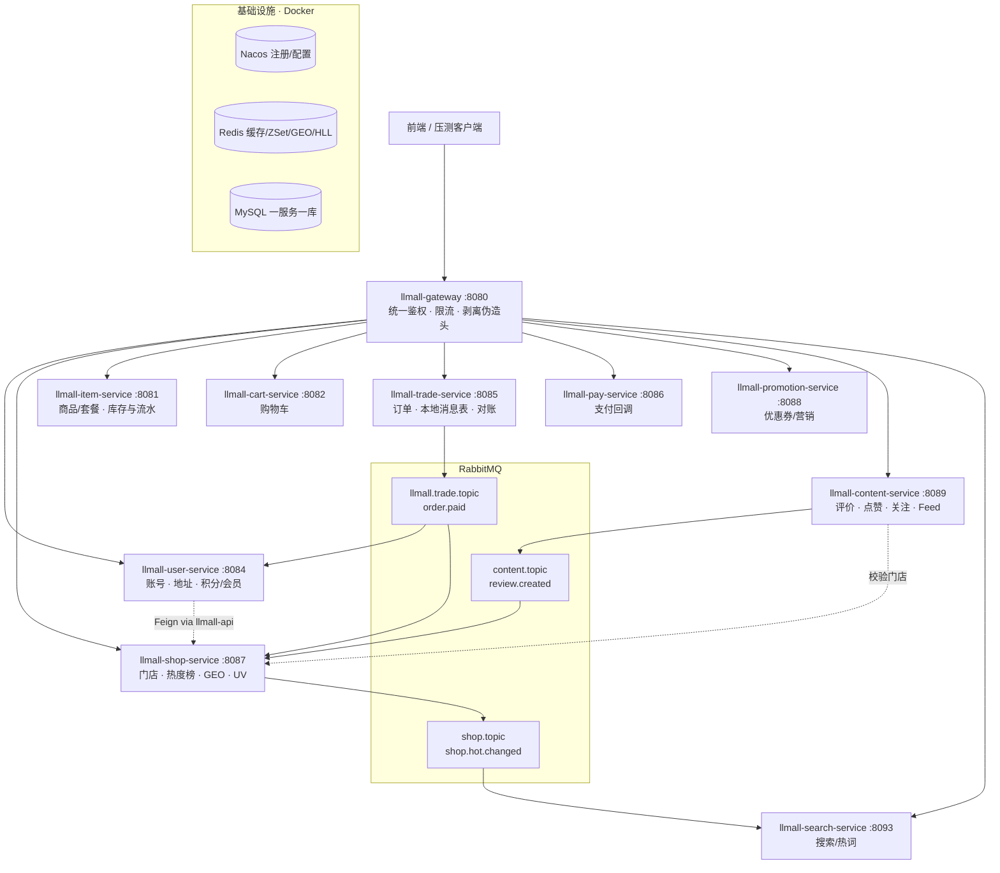
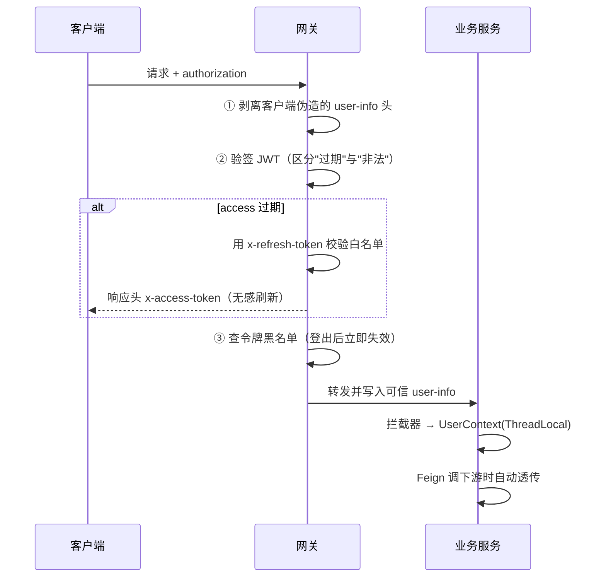
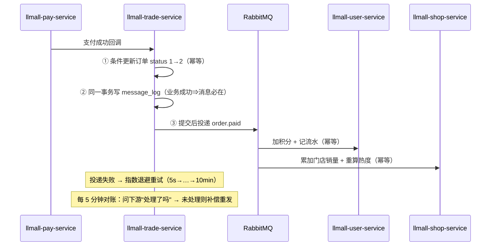
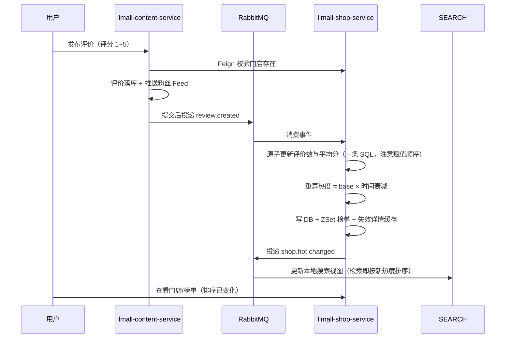

# 同城生活电商平台

> **一句话定位**：**10 个服务、一服务一库**的同城生活电商后端（1 网关 + 9 业务域），跑通
> 「逛门店 → 买套餐 → 下单支付 → 到店核销 → 写评价 → 门店热度/榜单」的完整业务闭环。
> 亮点不是"写完了"，而是**每条都带可复现的机器判据**：七道工程闸门、端到端 34 项断言、压测 + 账实核对。
>
> **技术栈**：Spring Boot 2.7 · Spring Cloud Alibaba 2021.0 · Nacos · OpenFeign · Gateway · Sentinel ·
> RabbitMQ · Redis · Elasticsearch 7.17 · MySQL 8 · MyBatis-Plus · Seata AT（可切开关，默认关）· Docker · JMeter

**三条一眼能看懂的数字**（口径与原始数据见「实测结果」、`benchmark/README.md`、`docs/P-01~P-03`）

| 维度 | 结果 |
|---|---|
| **资金安全** | 50 并发 × 60 秒写链路：**1,371 次支付成功 ⇔ 余额减少 35,097,600 分 = 25,600 × 1371.0**，一单一张支付单，并发双击只扣一次 |
| **读路径性能** | Feed 收件箱 100 并发 P99 **84 ms**、**每请求恒 1.0 条 SQL**（无 N+1）；ES 检索 P99 **47 ms** |
| **工程化** | **七道闸门 + 三态退出码 + 33 行台账**；端到端冒烟 **34 项通过 / 0 失败**；改一行配置也会被闸门精确点名 |

---

## 一、架构总览



**服务与数据归属（一服务一库）**

| 服务 | 端口 | 独占库 | 职责 |
|---|---|---|---|
| llmall-gateway | 8080 | — | 路由、JWT 签发/验签、限流、剥离伪造用户头 |
| llmall-user-service | 8084 | llmall-user | 账号（密码/验证码双通道）、地址、积分与流水、签到 |
| llmall-shop-service | 8087 | llmall-shop | 门店/类型、缓存三兄弟、热度分、ZSet 榜单、GEO、UV |
| llmall-item-service | 8081 | llmall-item | 商品/套餐、库存扣减与流水、门店套餐查询 |
| llmall-cart-service | 8082 | llmall-cart | 购物车 |
| llmall-trade-service | 8085 | llmall-trade | 订单（实物/团购券）、本地消息表、重试与对账 |
| llmall-pay-service | 8086 | llmall-pay | 支付单与回调 |
| llmall-promotion-service | 8088 | llmall-promotion | 优惠券发放/领取/核销、秒杀券（Lua 原子预扣减 + 一人一单 + MQ 异步落库） |
| llmall-content-service | 8089 | llmall-content | 评价/笔记、评论、点赞、关注、Feed |
| llmall-search-service | 8093 | llmall-search | 门店检索（ES 与 MySQL 读模型双引擎，`engine=auto` 优先 ES、不可用时自动回落）、热词与建议、搜索历史 |
| （规划中） | — | — | 站内信：**未实现**，仓库内无对应模块与配置 |

> **端口 8090 留给 Sentinel 控制台**（可选部署）。注意 Sentinel Dashboard 默认端口是 **8080，会与网关冲突**，
> 启动时必须显式指定 `-Dserver.port=8090`；10 个业务/网关服务的客户端地址已统一为
> `${llmall.sentinel.dashboard:192.168.189.128:8090}`（见「Sentinel 控制台」一节）。

---

## 二、三条核心链路

### 1）统一鉴权与身份透传（含防伪造加固）



### 2）跨域最终一致性（本地消息表 + 三层幂等 + 对账）



### 3）评价 → 门店热度 → 榜单排序（准实时闭环）



---

## 三、快速开始（本地开发）

```bash
# 1) 中间件（低内存版：MySQL + Redis + Nacos + RabbitMQ，约 1.6G）
docker network create local-life
docker compose -f ../docker/docker-compose-infra-lite.yml up -d

# 2) 建库建表：按 sql/merged/README.md 的顺序导入
# 3) 导入 Nacos 共享配置：见 nacos-config/README.md
# 4) 启动服务（IDEA 里按里程碑最小启动集跑，别一次全起）
#    建议 JVM 参数：-Xms64m -Xmx192m -XX:MaxMetaspaceSize=128m -XX:+UseSerialGC -XX:TieredStopAtLevel=1

# 5) 验证
curl http://localhost:8080/shops/1
pwsh -File ../scripts/verify-auth.ps1        # 亮点 A 端到端验收
```

**部署到服务器**：见 `deploy/部署说明.md`（Dockerfile + docker-compose-apps.yml + 环境变量模板）。
**压测**：见 `../benchmark/压测方案.md`（JMeter 计划 + 三组对比实验）。

---

## 四、技术选型与取舍（面试重点）

| 决策 | 选择 | 理由 / 代价 |
|---|---|---|
| 服务拆分粒度 | 按**领域**拆 10 个服务 | 一个服务 = 一个业务能力 + 独占数据 + 可独立演进；代价是分布式事务面变大 |
| 鉴权位置 | **只网关验签** | 收敛重复代码、性能好；代价是内网必须可信（配合入口剥离伪造头） |
| JWT 主动失效 | access 黑名单 + refresh 白名单 | 只对需失效部分引入状态，黑名单 TTL = 剩余寿命，不会膨胀 |
| 一致性方案 | **分层，并用对照实验校准过**：强一致用事务框架（Seata AT，可切开关、**默认关**），最终一致用本地消息表 | 实测 AT 让 `POST /orders` +259%、吞吐 −21%（`docs/P-03`），而收益只在下单失败回滚时兑现；因此默认关，只在"券与库存不能有中间态"这类需求出现时开启。三个 `seata.enabled` 必须同进同退（只开 trade 会造成少卖，台账 S-10） |
| 缓存击穿 | 逻辑过期 + 互斥锁 + 异步重建 | 牺牲一点实时性，换取"任何时刻都有数据可返回" |
| 榜单存储 | **Redis ZSet**（非 ES） | Top-N 排序毫秒级、极省资源；多条件检索才需要 ES |
| Feed 流 | **推拉结合**（阈值 1000） | 写扩散成本与粉丝数成正比，大 V 必须改拉模式 |
| 消息可靠性 | 本地消息表 + 重试 + 对账 | 不依赖 MQ 的 confirm 机制，方案自洽、可解释 |
| 幂等 | 三层唯一键 | 生产/消费/业务各一层，绝不假设 MQ 不重复 |
| 打包部署 | 单镜像多 jar | 10 个服务构建一次复用 10 次，省时省盘 |

---

## 五、项目亮点（量化数据为实测，口径与复现见 `benchmark/README.md` 与 `docs/P-01~P-03`）

- **鉴权收口 + 安全加固**：统一账号中台；发现并修复"免鉴权路径可伪造 `user-info` 冒充任意用户"的越权问题
- **可靠消息最终一致**：故障注入（消费者停机、消息重复投递 1000 次）验证**零丢单、零重复扣减**
- **准实时热度闭环**：门店排序更新延迟由 T+1 降至**秒级**
- **强一致 vs 最终一致：做过对照实验，有数据也有结论**（`docs/P-03-Seata-AT对照-2026-10-17.md`）：
  Seata AT **全链跑通并验证了回滚**（故障注入触发 `Branch Rollbacked result: PhaseTwo_Rollbacked`，
  库存 176→(扣 1)→176 不多不少，本地补偿钩子按守卫跳过、**无双回滚**）；
  同一份 JMX 跑 on/off：`POST /orders` Avg **68.9 → 247.7 ms（+259%）**、整链路吞吐 **73.9 → 58.5 rps（−21%）**，
  两态账实核对都精确成立 → **结论：默认关，收益只在下单失败回滚时兑现**
- **读路径实测**（Docker 容器 10 服务 + 容器 ES；JMeter 5.6.3，堆 `-Xmx512m`；宿主 i7-14650HX 16C/24T、15.8GB）：
  - Feed 收件箱读 `GET /follows/feed`：P95/P99 = **6 / 7 ms @10 并发**、**39 / 48 ms @50**、**70 / 84 ms @100**，错误率 0%；
    每请求恒为 **1.0 条 SQL**（并发与每页条数都不改变它）→ **读路径无 N+1**
  - 检索 `GET /search`（ES 30 条）：P99 **8 / 25 / 47 ms**（10/50/100 并发），错误率 0%
  - 商品列表 `GET /items/page`：容量上限由 Sentinel 规则锁定（阈值 **1000 QPS** = 实测容量 1500~1550 × 70%），
    超出即 400（设计内拒绝，不是故障；该键不在 Nacos，代码默认值即生效值）
- **写路径实测**：50 并发 × 60 秒、1,403 次下单 → 1,371 次支付成功，
  余额减少 35,097,600 分 = **25600 × 1371**（一次一扣、无重复扣款）；
  同一支付单 20 线程并发双击 → **1 次成功 + 19 次拒绝，只扣一次款**
- **口径说明**：JMeter 与被测容器跑在同一台宿主、抢同一批物理核，**QPS 绝对值不可与生产对标**；
  可信的是同环境下的并发梯度对比。完整环境规格与局限见 `benchmark/README.md`。
- **本机压测上限 ≈ 100 并发（硬上限，不再加码）**：16GB 宿主跑「10 个业务容器 + 中间件容器 + JMeter」时，
  100 并发已是可行上限（该档宿主峰值 CPU 到过 94%~100%，再往上会先触发内存 90% 熔断）；
  更高并发需要使用更强的机器或远程压测环境，本仓库的 JMX 并发全部由参数传入，换机器只需改 `-Threads`。

---

## 六、目录结构

```
llmall/
├── llmall-common/            共享库：统一响应、异常、UserContext、鉴权常量、MQ 转换器
├── llmall-api/              服务间契约：Feign 客户端 + DTO + 事件 + 降级
├── llmall-gateway/          网关：鉴权、限流、防伪造
├── llmall-user-service/        用户域
├── llmall-shop-service/        门店域
├── llmall-item-service/        商品域
├── llmall-cart-service/        购物车域
├── llmall-trade-service/       交易域（含本地消息表与对账）
├── llmall-pay-service/         支付域
├── llmall-promotion-service/   营销域（优惠券 + 秒杀）
├── llmall-content-service/     内容域
├── llmall-search-service/      搜索域（ES + MySQL 读模型双引擎）
├── gates/              工程化闸门（七道闸门 + 现行基线 + 自校验；见 gates/README.md）
├── docs/               规范与治理文档（注释规范 / 验收清单 / 已知偏差台账 等）
└── deploy/              Dockerfile / compose / 部署说明
```

### 工程化闸门（`gates/`）

「只改注释、代码零改动」这句话在本仓库里不是承诺，是**可复现的机器判据**。
闸门工具集、现行基线与自校验依赖都随仓库交付（`gates/`），clone 下来就能复现。
完整前置要求、基线更新流程与依赖来源见 `gates/README.md`。

**一条运行命令**（在仓库根目录执行）：

```powershell
pwsh -File gates\verify-all.ps1            # 七道闸门 + 13 模块编译；-SkipBuild 只跑分析闸门
```

只有 Windows PowerShell 5.1 的机器同样可用：`powershell -ExecutionPolicy Bypass -File gates\verify-all.ps1 -SkipBuild`
（闸门不要求 `PATH` 上有 `pwsh`——谁跑起闸门，子脚本就用同一个宿主跑；两种宿主下结论与退出码一致）。

**七道闸门各拦什么**：

| # | 闸门 | 拦什么 | 判据 | 类别 |
|---|---|---|---|---|
| 1 | Java 指纹 | 代码语义或**书写形态**被改 | FP1（token 流）= 0 且 FP2（代码行序列）= 0，且无「未被基线覆盖」的文件 | 硬 |
| 2 | YAML 指纹 | 配置项、缩进、结构被改 | 同上 | 硬 |
| 3 | Lua / SQL / 脚本指纹 | 非 Java/YAML 文件的代码被改 | 剥注释后代码行序列 SHA256 逐文件一致 | 硬 |
| 4 | 内容质量 | 11 类不该出现在注释里的东西 | HTML 标签 / 粗体 / 装饰横幅 / 历史叙述 / 实测叙述 / 口语化 / 待办标记 / 审计标签 / 迁移叙述 / 变更叙述 / 模板残留 = 全 0 | 硬 |
| 5 | 闸门自校验 | 闸门**自己**出错 | 34 个用例全过（剥离规则、内容规则、端到端指纹、Feign 重试的运行时对照） | 硬 |
| 6 | 字典一致性 | DDL 的取值与代码对不上 | 取值冲突 = 0、库名指向错误 = 0、同表同列表述不一 = 0 | 台账 |
| 7 | Feign 一致性 | 有写调用的服务漏配禁重试 | 用到写方法的服务必须显式引入 `NoRetryFeignConfig` | 台账 |

**三态退出码**（刻意分开，避免把「闸门失效」和「已登记偏差」混为一谈）：

| 退出码 | 含义 | 该怎么办 |
|---|---|---|
| `0` | 全绿 | — |
| `1` | **硬闸门失败** —— 闸门失效，或出现未登记的违规 | **必须修**，不得继续 |
| `2` | 硬闸门全过，台账闸门报出**已登记**的待处理偏差 | 逐条核对 `docs/已知偏差台账-2026-10-15.md` |

**真实全绿输出**（本仓库当前状态，pwsh 7.6.6 + JDK 11）：

```text
运行环境
  仓库根      : D:\dsh\llmall
  JDK         : D:\develop\jdk11  openjdk version "11.0.32.1" 2026-08-18 LTS
  PowerShell  : 7.6.6 (Core)  ...\pwsh.exe
  Maven       : D:\develop\apache-maven-3.9.6\bin\mvn.cmd

【1/7】Java 去注释指纹（280 文件）      FP1 代码语义变更 : 0   FP2 代码格式变更 : 0   结论: 通过
【2/7】YAML 去注释指纹（41 文件）       FP1 配置内容变更 : 0   FP2 配置格式变更 : 0   结论: 通过
【3/7】Lua / SQL / 脚本指纹             结论: 通过 —— 剥离注释后，代码逐行未变
【4/7】注释内容质量（11 条规则）        扫描文件 : 323   11 条规则全部 0 处   结论: 通过
【5/7】闸门自校验（34 用例）            通过 34 / 失败 0   结论: 全过
【6/7】字典与跨库引用一致性             ① 取值冲突 0   ② 疑似死状态 12（候选）   ③ 0   ④ 0   结论: 通过
【7/7】Feign 禁重试一致性               6 个客户端；4 个有写调用的服务全部已显式禁用   结论: 通过
【BUILD】全量编译（13 模块）            [INFO] BUILD SUCCESS   [INFO] Total time:  8.282 s

闸门汇总
  [PASS] Java 指纹                硬  退出码=0
  [PASS] YAML 指纹                硬  退出码=0
  [PASS] Lua/SQL/脚本指纹           硬  退出码=0
  [PASS] 内容质量                   硬  退出码=0
  [PASS] 闸门自校验                  硬  退出码=0
  [PASS] 字典一致性                  台账  退出码=0
  [PASS] Feign 一致性              台账  退出码=0
  [PASS] 全量编译                   硬  退出码=0

结论: 全绿
```

### 一键运行（`demo.ps1`）

`demo.ps1` 只**编排仓库里既有的材料**，不重造任何东西：`mvn package` + `deploy/Dockerfile` 构建单镜像 →
`docker/docker-compose-infra-lite.yml` + `docker/docker-compose-addon.yml` 的 `elasticsearch` 起中间件 →
按 `sql/merged/README.md` 的顺序建库灌数（**52 冻结不执行**，执行前先跑 `52a` 只读清点且要求 verdict = 0）→
Nacos Open API 导入 `nacos-config/*.yaml` 与 `gateway-routes.json` → `gates/EsBulkLoad.java` + `es-shop-mapping.json` 灌 ES →
`deploy/docker-compose-apps.yml --profile full` 起应用 → `scripts/MallE2E.java` 冒烟（结果写进 `logs/demo/demo-report-*.md`，
含 `docker stats` 峰值内存）。

三条命令：

```powershell
pwsh -File demo.ps1 -Reset     # 停容器 + 删卷 + 删网络（幂等）
pwsh -File demo.ps1            # 全流程；冒烟全绿则退出码 0
pwsh -File demo.ps1 -Down      # 收尾（加 -Volumes 连数据卷一起删）
```

前置：**Docker**（脚本会先跑 `-Preflight` 式检查，缺 docker 时退出码 2 并给出提示）、
JDK 11 与 Maven（`-SkipBuild` 可复用已有镜像）。只有 Windows PowerShell 5.1 的机器同样可用。
`--profile` 默认 `full` 而不是 `core`：冒烟链路要 trade/cart/pay/promotion/search，`core` 起不全必然红。
ES 默认起 addon 容器；若 ES 已在本机原生安装（含 IK 插件），用 `-ExternalEs -EsUrl http://127.0.0.1:9200`
让脚本复用外部实例、不抢 9200 端口。Nacos 导入是**幂等且不覆盖**的：远端不存在或已一致才写，
遇到与仓库版本不一致的配置会停下并列出清单（要用仓库版本覆盖它们得显式加 `-ForceNacos`）。

### 开发约定：注释规范

- **规范正文**：`docs/注释规范.md` —— 八类注释（类 / 方法 / 行内 / 风险警示 / 配置 / Lua / SQL / TODO）的写法，以及各模块必须写清的口径（JWT 闭环、库存口径、三态语义、会话水位等）。
- **逐条验收**：`docs/注释验收清单-2026-10-15.md`。
- **改注释必须过闸门**：用去注释指纹证明「只改注释、代码零改动」，命令见上节与 `gates/README.md`。

## 七、配套文档（仓库外）

| 文档 | 内容 |
|---|---|
| `设计文档-v1.1.md` | 架构与服务划分、亮点设计方案 |
| `M1/M2/M3/M4/M5/M6-进展与验收.md` | 各阶段实现细节、缺陷修复与验收步骤 |
| `资源受限运行方案.md` | 16G 机器怎么跑起来（VM 内存、JVM 参数、最小启动集、ES 决策） |
| `压测方案.md` / `locallife-benchmark.jmx` | 压测场景与脚本 |
| `简历材料.md` / `面试问答手册.md` | 简历措辞与面试题答法 |

## 八、演进路线

- [x] llmall-promotion-service：优惠券与秒杀（Redis Lua 预扣减 + 一人一单 + MQ 异步落库）
- [x] llmall-search-service 演进：ES 检索实现 + 读模型同步（`engine=auto` 优先 ES，不可用时回落 MySQL 读模型）
- [ ] 检索双引擎对照压测（同一份代码跑 `engine=es` 与 `engine=mysql` 各一轮）
- [x] Seata AT 对照实现 + 双方案对比压测（TP99 / 锁等待 / undo_log）
  —— 已完成，结论与两态数据见 `docs/P-03-Seata-AT对照-2026-10-17.md`：
  **AT 全链跑通（含 `PhaseTwo_Rollbacked` 回滚实证）**；`POST /orders` Avg 68.9 → 247.7 ms（+259%）、
  整链路吞吐 73.9 → 58.5 rps（−21%）；**默认值已回落 `false`**（回落经 SHA256 逐字节校验 + 闸门全绿）。
- [ ] 依赖版本对齐：seata 客户端 1.6.1 / 服务端 1.5.2 倒挂，且 jar 内 `seata-all-1.6.1` 与
  `seata-core/common/discovery/config-1.5.2` 混装（台账 S-11）
- [ ] 链路追踪：Micrometer Tracing / SkyWalking + traceId 贯穿日志
- [ ] 优雅停机、灰度发布
- [ ] Sentinel 规则持久化到 Nacos（当前规则由 `SentinelRuleConfig` 代码静态注册，控制台推送的规则重启即丢）

## 九、Sentinel 控制台（可选部署）

**当前形态**：控制台与**应用同机**运行（Windows 宿主，端口 8090），jar 在
`D:\Javadir\llmall\sentinel\sentinel-dashboard.jar`（官方 dashboard **1.8.6**）。
客户端是 `spring-cloud-alibaba 2021.0.4.0` 带进来的 **sentinel-core 1.8.5**（实测
`/app/{app}/machines.json` 返回 `"version":"1.8.5"`）——与控制台 1.8.6 同属 1.8.x，
向下兼容，不需要为了"版本一致"去换控制台。

限流与熔断规则由 `SentinelRuleConfig` 在启动时**用代码静态注册**（`ItemController#queryItemByPage` 上有
唯一一处 `@SentinelResource`，用于标记被保护的资源），**控制台不在线规则照样生效**
（日志里只有 `failed to connect to dashboard` 级别的告警，不影响业务）。控制台的作用是
**实时看 QPS/RT/拒绝数并动态改规则**。

**地址口径（已统一）**：所有服务读同一个占位符，默认值即"控制台与应用同机"，改地址只改一处：

```yaml
spring:
  cloud:
    sentinel:
      transport:
        dashboard: ${llmall.sentinel.dashboard:localhost:8090}
```

覆盖方式（三种任选其一，无需改代码）：

| 场景 | 怎么给值 |
|---|---|
| IDEA / 本机 `java -jar` | 不用给，默认值就是 `localhost:8090` |
| 控制台搬到 VM 或另一台机器 | 启动参数 `--llmall.sentinel.dashboard=ip:port`，或环境变量 `LLMALL_SENTINEL_DASHBOARD=ip:port` |
| 想让所有服务一起改 | Nacos 配置里加 `llmall.sentinel.dashboard: ip:port`（远程配置优先级高于本地 application.yaml） |

**启动控制台**（端口必须是 8090：控制台自身默认 8080，会和网关撞端口）：

```powershell
java -Dserver.port=8090 -Dcsp.sentinel.dashboard.server=localhost:8090 `
     -Dproject.name=sentinel-dashboard -jar D:\Javadir\llmall\sentinel\sentinel-dashboard.jar
```

默认账号密码 `sentinel/sentinel`。

**验收**（起控制台 → 起任一服务 → 控制台左侧出现服务名、`簇点链路` 里有接口资源）：

```bash
curl -c cookie.txt -X POST -d 'username=sentinel&password=sentinel' http://localhost:8090/auth/login
curl -b cookie.txt http://localhost:8090/app/names.json                      # 已注册的应用
curl -b cookie.txt http://localhost:8090/app/llmall-cart-service/machines.json      # 机器详情（ip/port/health/version）
```

> 注意：登录路径**没有** `/api/v1` 前缀（`/api/v1/**` 是给界面用的，未登录时一律 401，容易被误判成"接口不存在"）。

**两个必须知道的细节**（都是实测出来的）：

1. **客户端默认是惰性注册**：`spring.cloud.sentinel.eager` 默认 `false`，客户端要等**第一次业务请求**
   才会绑定命令端口并向控制台发心跳——所以"服务起来了、控制台里却是空的"往往不是没连上，而是还没人访问过它。
   本项目 5 个真正引了客户端的服务（cart / shop / content / promotion / search）都已显式配
   `eager: true`，启动即注册；不想要这个行为就把它删掉（退回默认）。
2. **控制台自注册会占用宿主 8719**：启动命令里的 `-Dcsp.sentinel.dashboard.server=localhost:8090`
   会让控制台自己也当一个 Sentinel 客户端，于是它占住 8719，同机应用的默认命令端口就被挤掉——
   本轮实测 llmall-cart-service 只能落到 8720。要么给应用显式指定 `spring.cloud.sentinel.transport.port`，
   要么去掉控制台的自注册参数（代价：控制台自己不会出现在应用列表里）。

**为什么是"控制台与应用同机"**：Sentinel 的规则是**控制台 → 客户端 8719 端口**反向推送的。
控制台在 VM、服务在 Windows 时，客户端上报的是 WLAN 地址（`192.168.31.x`），VM 连不上，
表现为"机器列表能看到、加了流控规则却不生效"。真要把控制台搬到 VM（或以后服务进容器），
需要三件事一起做：① 服务加 `--spring.cloud.sentinel.transport.client-ip=192.168.189.1`；
② Windows 放行 8719 入站；③ 控制台容器与应用容器接同一个 `local-life` 网络。

> 配置侧的两个已知细节：
> ① 10 个模块都写了 `sentinel.transport.dashboard`，但只有 **cart / shop / content / promotion / search**
> 这 5 个模块引了 `spring-cloud-starter-alibaba-sentinel` 依赖，另外 5 个（gateway / item / pay / trade / user）
> 的这段配置目前是**空转**的（无害）；要让它们也接控制台，得先补依赖。
> ② 历史上这段配置的默认值是 `192.168.189.128:8090`（"控制台部署在 VM"的口径）。按实际拓扑
> （服务在 Windows IDEA、中间件在 VM）改成 `localhost:8090` 后，IDEA 里起服务即可直接连上控制台；
> 变更记录见 `../最终验收与交付清单.md` 第九节。
