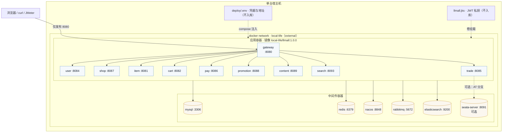
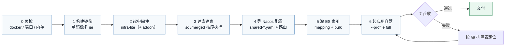

# 部署说明

> 目标：把 10 个服务（1 网关 + 9 业务域）与中间件跑起来，并给出**可逐条勾选的验收口径**。
> 本文只写与部署有关的东西；凭据轮换、攻击面收口见 [`../README.md`](../README.md) 第十节。

---

## 0. 前置条件

| 项 | 要求 | 说明 |
|---|---|---|
| Docker | 23+（内置 BuildKit） | 构建阶段用 `RUN --mount=type=cache`；老版本需 `DOCKER_BUILDKIT=1` |
| JDK | 11 | 镜像内构建不需要本机 JDK，只有走 `-SkipBuild` 复用镜像时才省事 |
| Maven | 3.9+ | 同上；`deploy/settings.xml` 随仓库走，不依赖宿主 `~/.m2` |
| 内存 | **≥ 8 GB**（全量）/ **≥ 4 GB**（`core` profile） | 每服务 `-Xmx192m`、容器 `mem_limit: 256m` |
| 端口 | 8080（网关）、8848/9848（Nacos）、3306、6379、5672、9200 | 中间件端口默认只绑 `127.0.0.1` |
| 磁盘 | ≥ 10 GB | 镜像 + 数据卷 + ES 索引 |

---

## 1. 部署形态

| 形态 | 适用场景 | 做什么 |
|---|---|---|
| **A. 全量容器化**（推荐） | 演示环境、云服务器 | 中间件 + 10 个应用容器全在 Docker 里 |
| **B. 中间件容器 + IDEA 跑服务** | 日常开发、单点调试 | 只用 `docker/docker-compose-infra-lite.yml`，服务在 IDE 里起 |
| **C. 复用已有中间件** | 已有一套在跑的 MySQL/Redis/Nacos/MQ | 只把新容器接进同一网络，不动现有数据 |

`core` profile 只覆盖 **gateway + user + shop + item + content**（5 个），够跑"逛门店 / 登录 / 看评价"，
但**跑不了端到端冒烟**（冒烟要 trade/cart/pay/promotion/search）。小内存机器先用 `core` 验证链路，
再切 `full`。

---

## 2. 拓扑



**网络是硬约束**：应用容器里用的是**容器名**（`LLMALL_DB_HOST=mysql`、`NACOS_ADDR=nacos:8848`、
`LLMALL_ES_HOST=elasticsearch`），只有与中间件处于**同一个 Docker 网络**时才解析得到。
三份编排文件（`infra-lite` / `addon` / `apps`）统一接入 external 网络 `local-life`，
不同网络时的典型报错是 `java.net.UnknownHostException: mysql`。

---

## 3. 首次部署流程



一条命令跑完上面 0~7 步（推荐，见 [`../README.md`](../README.md) §4.1）：

```powershell
pwsh -File demo.ps1
```

下面各节是**手工等价操作**，用于理解每一步在做什么，或在 CI/自动化里替换其中某一步。

---

## 4. 构建镜像

```bash
# 在仓库根目录执行
docker build -f deploy/Dockerfile -t local-life/llmall:1.0.0 .
```

**单镜像多 jar**：镜像内含 10 个服务的 jar，容器通过 `command` 指定启动哪个。
这样 10 个服务只构建一次、复用 10 次；生产上若各服务发布节奏不同，再拆成一服务一镜像。

构建要点（都在 `deploy/Dockerfile` 的注释里写清了）：

- **先只拷各模块的 `pom.xml`** 再 `dependency:go-offline`，改源码不会触发依赖重下；
- `RUN --mount=type=cache,target=/root/.m2` 让依赖缓存不落进最终镜像层；
- `deploy/settings.xml` 随仓库走（Maven 镜像源），构建不依赖宿主 `~/.m2`；
- 运行阶段固定 `TZ=Asia/Shanghai` 与低内存 `JAVA_OPTS`。

首次构建需要联网。若构建卡住，看日志里是否出现 `Downloading from ...`——卡在 TLS 握手
通常意味着镜像源不可达，而不是"还在下载"。

---

## 5. 起中间件

### 5.1 用仓库提供的编排（全新机器 / 云服务器）

```bash
docker network create local-life
docker compose -f docker/docker-compose-infra-lite.yml up -d
# 需要 ES / Seata / Kibana 时再叠加：
docker compose -f docker/docker-compose-addon.yml up -d
```

`infra-lite` 提供 MySQL / Redis / Nacos / RabbitMQ / Seata / Elasticsearch，容器名即
`mysql` / `redis` / `nacos` / `rabbitmq` / `seata` / `elasticsearch`。

### 5.2 复用已有中间件（不动数据）

已在跑的中间件不需要重建——新建容器会用新数据卷（库表全空），而且旧容器已占用容器名与端口，
`up` 会因为"名字已存在 / 端口已分配"起不来。**把它们接进同一网络**才是零停机、不动数据的做法：

```bash
docker network create local-life

# 把现役容器接进来（重复执行报 "endpoint with name ... already exists in network" 属正常，
# 恰好说明上一次已经连上了）
for c in mysql nacos rabbitmq; do docker network connect local-life "$c"; done

# 验收：期望列出全部中间件容器名
docker network inspect local-life -f '{{range .Containers}}{{.Name}} {{end}}'
docker exec -it rabbitmq getent hosts mysql     # 容器间按名字互访
```

> ⚠️ 存在两种常见差异，改 `.env` 即可适配，**不需要改代码**：
> ① 容器名不同（例如 RabbitMQ 叫 `mq`）→ 改 `LLMALL_MQ_HOST`；
> ② Redis 不是容器而是宿主机原生安装 → `LLMALL_REDIS_HOST` 填宿主机 IP（容器内的
> `127.0.0.1` 指的是容器自己）。

> ⚠️ `deploy/docker-compose-infra-lite.yml` **已废弃**（内容合并进 `docker/docker-compose-infra-lite.yml`），
> 里面只剩说明文字，别再用它起中间件。

---

## 6. 初始化数据与配置

### 6.1 建库建表

严格按 [`../sql/merged/README.md`](../sql/merged/README.md) 的顺序执行。要点：

- 脚本**可重放**：裸 `ALTER` 都带守卫，重复执行不报错；
- **52 号脚本冻结不执行**（历史数据清理），执行前只跑 `52a` 只读清点并要求 `verdict = 0`；
- 建库脚本 `00-create-databases.sql` 会一次性建出 9 个业务库与对应账号授权。

```bash
docker exec -i mysql mysql -uroot -p"$MYSQL_ROOT_PASSWORD" < sql/merged/00-create-databases.sql
# 其余脚本按 README 列表顺序逐个执行
```

### 6.2 导入 Nacos 配置

按 [`../nacos-config/README.md`](../nacos-config/README.md) 导入 `shared-*.yaml`、
`llmall-pay-service.yaml` 与 `gateway-routes.json`。要点：

- 共享配置（`shared-jdbc` / `shared-redis` / `shared-mq` / `shared-log` / `shared-es`）**远程生效**，
  容器里的 `bootstrap.yaml` 只负责拉取；
- `shared-log.yaml` 缺失时 Nacos 会**静默忽略**，日志格式与级别悄悄回落默认值；
- 导入是**幂等且不覆盖**的：远端不存在或已一致才写，与仓库版本不一致时停下并列出清单。

### 6.3 灌 ES 索引

```bash
java gates/EsBulkLoad.java        # 建 mapping + bulk 导入门店文档
```

mapping 用 `gates/es-shop-mapping.json`——**必须用这份**：ES 对显式 mapping 的字段类型极敏感，
换成手工改过的版本会被直接拒绝。

---

## 7. 起应用

```bash
cd deploy
cp .env.example .env          # 按实际环境改地址与口令（对外部署前逐项轮换，见 README §10.3）

docker compose -f docker-compose-apps.yml --profile core up -d   # 最小集（5 个）
docker compose -f docker-compose-apps.yml --profile full up -d   # 全量（10 个）
```

日常操作：

```bash
docker compose -f docker-compose-apps.yml ps
docker compose -f docker-compose-apps.yml logs -f gateway
docker compose -f docker-compose-apps.yml --profile full restart llmall-trade-service
```

> `.env` 里的值经 compose 的 `x-app` 锚点统一注入到每个应用容器；改地址/口令只改这一处。
> `${VAR:?}` 拦的是"变量没定义"，**不拦"值还是演示值"**——对外部署必须人工替换。

---

## 8. 验收清单

逐条勾选，任何一条不通过都视为部署未完成。

| # | 检查项 | 命令 / 判据 |
|---|---|---|
| 1 | 网络里同时能看到中间件与应用容器 | `docker network inspect local-life -f '{{range .Containers}}{{.Name}} {{end}}'` |
| 2 | Nacos 能看到全部已启动服务 | `curl http://127.0.0.1:8848/nacos/v1/ns/service/list?pageNo=1&pageSize=20` |
| 3 | 网关到门店服务链路通 | `curl http://127.0.0.1:8080/shops/1` 返回门店 JSON |
| 4 | 鉴权链路端到端可用 | `pwsh -File scripts/verify-auth.ps1` 全绿 |
| 5 | 没有容器突破内存上限 | `docker stats --no-stream`，单容器 < 256 MB |
| 6 | 一条业务闭环可跑通 | 登录 → 浏览门店 → 发布评价 → 门店热度/榜单变化 |
| 7 | 检索命中 | `curl "http://127.0.0.1:8080/search?keyword=火锅"` 返回结果 |
| 8 | 压测脚本能打到网关 | 见 [`../benchmark/README.md`](../benchmark/README.md) |
| 9 | （装了控制台才有）控制台能看到服务名与实例 | Sentinel 控制台「机器列表」有该应用的 IP:8719 |

---

## 9. 运行时口径

### 9.1 内存与稳定性

| 项 | 做法 |
|---|---|
| 每个服务 | `-Xms64m -Xmx192m -XX:MaxMetaspaceSize=128m`，容器 `mem_limit: 256m`（已在 Dockerfile 与 compose 里设好） |
| 中间件 | MySQL 关 `performance_schema`、Redis `maxmemory 96mb`、Nacos `Xmx384m` |
| 只有 4G 内存 | 用 `core` profile，或另维护一份只含必要服务的 compose |
| 启动顺序 | 中间件 → 服务；服务对 Nacos 有重试，晚起也能自愈 |
| 优雅停机 | compose 的 `JAVA_OPTS` 统一加 `-Dserver.shutdown=graceful -Dspring.lifecycle.timeout-per-shutdown-phase=30s`，并设 `stop_grace_period: 40s`（默认 10 秒会把在途下单/核销直接 SIGKILL）；`shared-log.yaml` 里也放了同一组设置，两条路径任一生效即可 |
| 健康探针 | 所有服务/网关随父 pom 引入 actuator，暴露 `/actuator/health`（含 liveness/readiness 分组）；compose 已配 `healthcheck`（容器内无 curl，用 wget 探已知端口）。⚠️ **不要把 `/actuator/**` 加进网关白名单** |
| Feign 降级 | `llmall-trade-service` 已补 `spring-cloud-starter-alibaba-sentinel` + `feign.sentinel.enabled: true`——否则它声明的 `fallbackFactory` 永远不被调用（`DefaultTargeter` 不读 fallback，只有 Sentinel 的 Builder 才消费），属"看起来有降级"的假安全 |

### 9.2 时区口径（统一 Asia/Shanghai / CST）

| 位置 | 现状 | 靠什么保证 |
|---|---|---|
| 宿主 / 云服务器 | `Asia/Shanghai` | `timedatectl set-timezone Asia/Shanghai` |
| `mysql` 容器 | CST（`@@system_time_zone=CST`） | 容器 `TZ` + `--default-time-zone=+08:00` |
| `nacos` 容器 | CST | `TZ` + `/etc/localtime -> Asia/Shanghai` |
| `rabbitmq` 容器 | CST | `TZ` + **挂宿主 `/etc/localtime`**（该镜像不带 tzdata，**只设 `TZ` 无效**） |
| `seata-server` 容器 | CST | `TZ` + 挂 `/usr/share/zoneinfo`（Alpine 镜像**连 `jre/lib/zi` 都没有**） |
| 应用（容器或 IDE） | CST | `Dockerfile` 的 `ENV TZ` + compose 的 `x-app` 锚点 |
| 数据库连接串 | `serverTimezone=Asia/Shanghai` | `nacos-config/shared-jdbc.yaml` |

```bash
timedatectl | head -4
for c in mysql nacos rabbitmq seata; do echo "$c: $(docker exec $c date)"; done
docker exec mysql mysql -uroot -p -N -e "SELECT @@system_time_zone, NOW();"
```

> ⚠️ **手工改动只活在容器可写层**：`docker cp /etc/localtime`、`ln -sf` 这类修法在 `docker restart`
> 后还在，但容器一旦被 **recreate**（compose 重建）就全丢。所以两份编排文件都把 `TZ` 与
> `/etc/localtime`（Seata 另加 `/usr/share/zoneinfo`）补齐了——重建后自带 CST。

### 9.3 容器重建的两个 MQ 坑

数据卷还在、命令也没报错，但服务就是起不来——迁移、改配置、升级镜像都会触发。
详见 [`容器重建注意事项.md`](容器重建注意事项.md)：RabbitMQ 节点名漂移导致 vhost/队列"消失"、
延迟消息插件重建后回到未启用状态（trade 启动即 `QueuesNotAvailableException`）。

---

## 10. 排障表

| 现象 | 原因 / 处理 |
|---|---|
| 服务起来但 Nacos 里看不到 | `NACOS_ADDR` 填错，或服务与 Nacos 不在同一 Docker 网络（`docker exec -it llmall-user-service ping nacos`） |
| 报 `UnknownHostException: mysql` | 同上：容器名解析不到，检查 `docker network inspect local-life` |
| 构建报 `Cannot access ... in offline mode` | 用了 `-o`？去掉离线参数，或先联网 reload 一次 |
| 构建报 `unknown flag: mount` | Docker 版本低于 23 且未开 BuildKit：`DOCKER_BUILDKIT=1 docker build ...` |
| 门店详情 500，日志报 Redis 连接失败 | `LLMALL_REDIS_HOST` / `LLMALL_REDIS_PW` 不对；容器里不能写 `127.0.0.1`（那是容器自己） |
| 明明改了配置但不生效 | Nacos 共享配置是**远程生效**的，容器内 `bootstrap.yaml` 只负责拉取；改配置去 Nacos 控制台 |
| trade 启动即 `QueuesNotAvailableException` | 延迟消息插件未启用，见 [`容器重建注意事项.md`](容器重建注意事项.md) |
| `Too many connections` | 服务被反复重启，连接未回收（`wait_timeout` 默认 8 小时）；连接池上限已压到 5 |
| 容器被 OOM Kill | 内存超卖：减服务数量（`core` profile）或升配/加 swap |
| 时区差 8 小时 | 容器被 recreate 后丢了 `TZ` 与 `/etc/localtime`；用仓库编排重建而不是手工改 |

---

## 11. 可选组件：Sentinel 控制台

控制台**不是运行必需**：限流与熔断规则由 `SentinelRuleConfig` 在启动时用代码**静态注册**
（唯一一处 `@SentinelResource` 在 `ItemController#queryItemByPage`，用于标记被保护的资源），
所以控制台不在线，规则照样生效；控制台的作用是**实时看 QPS/RT/拒绝数并动态改规则**，
但控制台推送的规则**重启即丢**（持久化到 Nacos 仍是待办）。

| 项 | 值 |
|---|---|
| 端口 | **8090**（控制台自身默认 8080，会与网关冲突，必须显式 `-Dserver.port=8090`） |
| 版本 | 控制台 1.8.6 / 客户端 1.8.5（同属 1.8.x，向下兼容，不需要为了"版本一致"换控制台） |
| 地址口径 | 所有服务读同一个占位符 `${llmall.sentinel.dashboard:localhost:8090}`，改地址只改一处 |
| 已接客户端的服务 | cart / shop / content / promotion / search（另 5 个模块的这段配置目前是空转，无害） |

```bash
java -Dserver.port=8090 -Dcsp.sentinel.dashboard.server=localhost:8090 \
     -Dproject.name=sentinel-dashboard -jar sentinel-dashboard.jar   # 默认账号 sentinel/sentinel

curl -c cookie.txt -X POST -d 'username=sentinel&password=sentinel' http://localhost:8090/auth/login
curl -b cookie.txt http://localhost:8090/app/names.json                      # 已注册的应用
curl -b cookie.txt http://localhost:8090/app/llmall-cart-service/machines.json
```

> 登录路径**没有** `/api/v1` 前缀（`/api/v1/**` 是给界面用的，未登录一律 401，容易被误判成"接口不存在"）。

**三个实测坑**：

1. **客户端默认惰性注册**：`spring.cloud.sentinel.eager` 默认 `false`，客户端要等第一次业务请求
   才会绑定命令端口并上报心跳——"服务起来了、控制台里却是空的"往往不是没连上，而是还没人访问过。
   本项目 5 个真正引了客户端的服务都已显式配 `eager: true`。
2. **控制台自注册会占用 8719**：启动命令里的 `-Dcsp.sentinel.dashboard.server` 会让控制台自己也
   当一个客户端，于是占住 8719，同机应用的默认命令端口被挤掉。要么给应用显式指定
   `spring.cloud.sentinel.transport.port`，要么去掉控制台的自注册参数。
3. **规则是控制台 → 客户端 8719 反向推送**：控制台与应用不同机时，客户端上报的地址可能是控制台
   不可达的内网地址，表现为"机器列表能看到、加了流控规则却不生效"。跨机部署需要三件事同时满足：
   ① 客户端用 `client-ip` 上报一个控制台可达的地址；② 该地址的 8719 对控制台放行；
   ③ 控制台容器与应用容器在同一 Docker 网络。

---

## 12. 部署后的凭据轮换

部署完成 ≠ 可以对外开放。**对外或对局域网开放前**，必须先按
[`../README.md`](../README.md) §10.3 的六类凭据逐项轮换，并确认：

- `deploy/.env` 里没有残留 `deploy/.env.example` 的演示值；
- `llmall.jks` 是用自行生成的口令重新生成的（轮换后所有已签发 JWT 立即失效，属预期）；
- 中间件端口未对公网暴露（默认只绑 `127.0.0.1`），对外只发布网关 8080。
