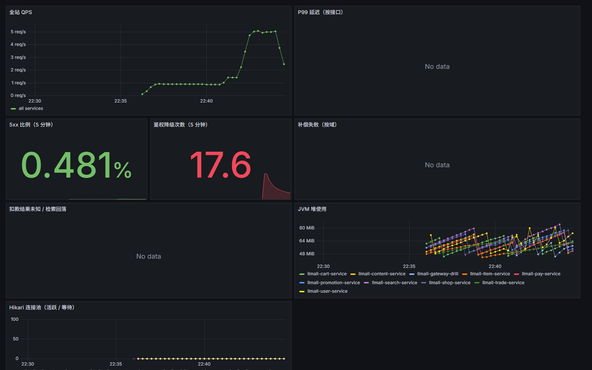
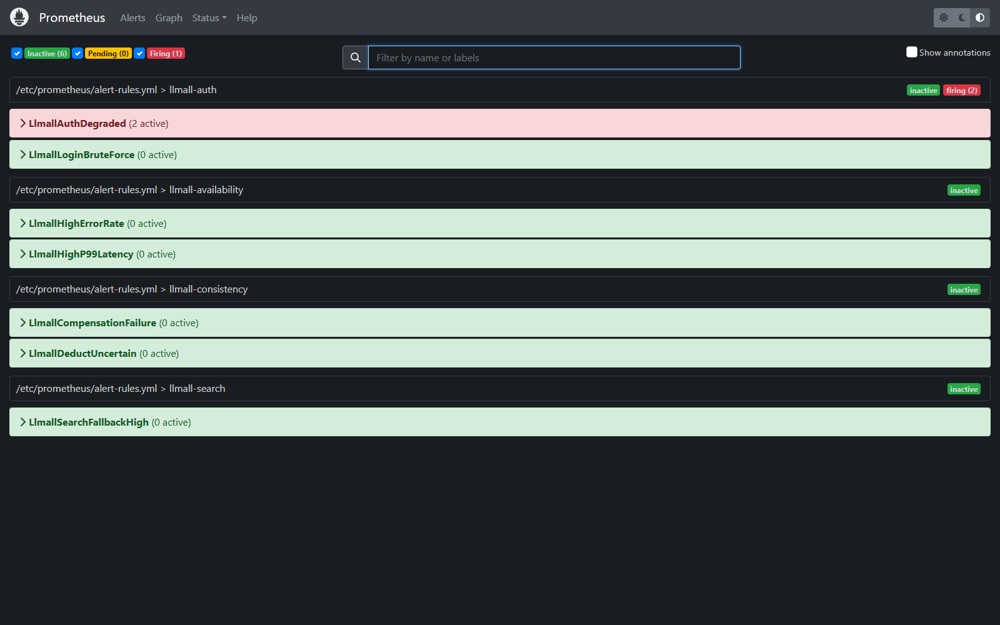
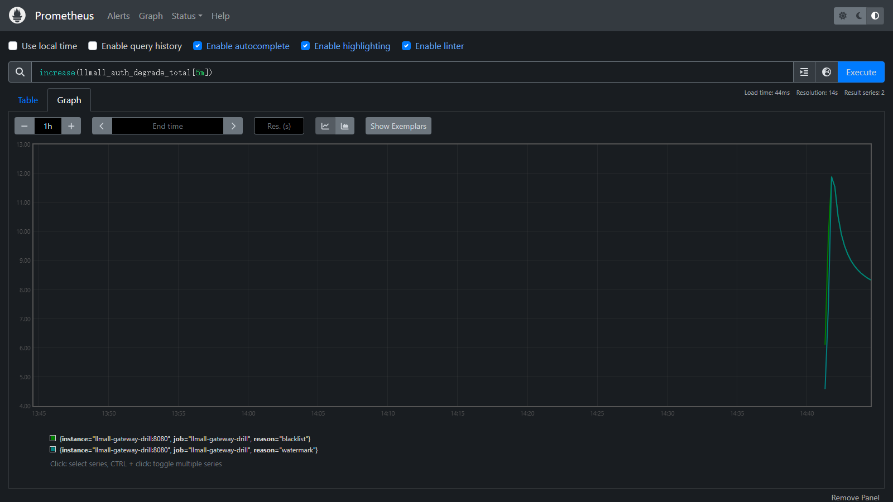

# 鉴权降级演练记录（2026-10-24）

> 这是**实际执行**的记录，不是待办手册。环境为 Windows Docker Desktop 上的本地演示栈；
> 结论只对本次环境成立，QPS 等绝对值不可对标生产。

## 1. 环境与前置

| 项 | 值 |
|---|---|
| 运行栈 | 10 个业务服务 + mysql / redis（含 3 哨兵）/ nacos / mq，镜像 `local-life/llmall:1.0.0`（2026-10-21 构建） |
| 观测栈 | Prometheus 2.53、Grafana 11.1（`deploy/docker-compose-observability.yml --profile obs`） |
| 演练网关 | 临时容器 `llmall-gateway-drill`，只读挂载**本次新构建**的 `llmall-gateway.jar`，发布 18080，关闭 Nacos 注册避免与线上网关实例冲突 |
| 指标放行 | 仅该实例设置 `llmall.actuator.prometheus-public=true`；默认 false，生产仍只暴露 health |
| 数据 | 演示库种子账号 `Jack`，登录拿到 access token 后压 `/users/me` |

## 2. 时间线（2026-10-24，CST）

| 时间 | 动作 | 观测 |
|---|---|---|
| 22:40:09 | 演练网关启动完成 | `/actuator/health` 200、`/actuator/prometheus` 200 |
| 22:40:42 | 以 Jack 登录拿到 access token，开始按约 2.5 req/s 请求 `/users/me` | 请求正常 |
| 22:40:50 | `docker stop redis`（主节点+哨兵一起停） | 网关黑名单查询失败，进入 fail-open |
| 22:41:38 | `docker start redis` | Redis 恢复 |
| 22:43:52 | 停止压测流量 | — |
| 22:44:27 | 查询指标与告警 | `sum(increase(llmall_auth_degrade_total[10m])) = 17.32`；`LlmallAuthDegraded` **firing**（2 个 active series） |

## 3. 证据

**Grafana 看板**（鉴权降级 17.6，5xx 比例 0.481%）：



**Prometheus 告警页**（Firing 1，`LlmallAuthDegraded (2 active)`）：



**指标曲线**：



原始查询与告警状态（截图时点）：

```text
sum(increase(llmall_auth_degrade_total[10m])) = 17.320968918410877
LlmallAuthDegraded  firing  severity=page  (2 active)
```

## 4. 结论

1. **fail-open 生效**：Redis 停机期间，带鉴权的 `/users/me` 没有整站 401，而是放行并计数；
   与设计文档「可用性优先、故障窗口内提前失效能力暂时失效」一致。
2. **指标可用**：`llmall_auth_degrade_total{reason="blacklist"}` 在故障窗口内增长，恢复后不再增长。
3. **告警可用**：`increase(...[5m]) > 0` + `for: 1m` 按预期进入 firing，`severity=page` 正确。
4. **影响面可控**：窗口内 5xx 比例 0.481%，未触发 `LlmallHighErrorRate`（阈值 1%）。
5. **恢复后无残留**：Redis 恢复后指标不再增长；演练网关已删除，`targets-drill.json` 复位为空。

## 5. 边界（不要说过头）

- 演练用的是**临时网关实例**，只是为了在不重建 10 个容器的情况下验证新指标；它不代表整栈已升级。
- 未接 Alertmanager，告警只到 Prometheus 规则与 Grafana 面板，**没有真实通知渠道**。
- 没有做链路追踪（只有 traceId 日志），所以“从告警点到具体 span”这一段无法演示。
- 生产环境**不得**开启 `llmall.actuator.prometheus-public`；网关指标应由内网直连或独立管理端口采集。
