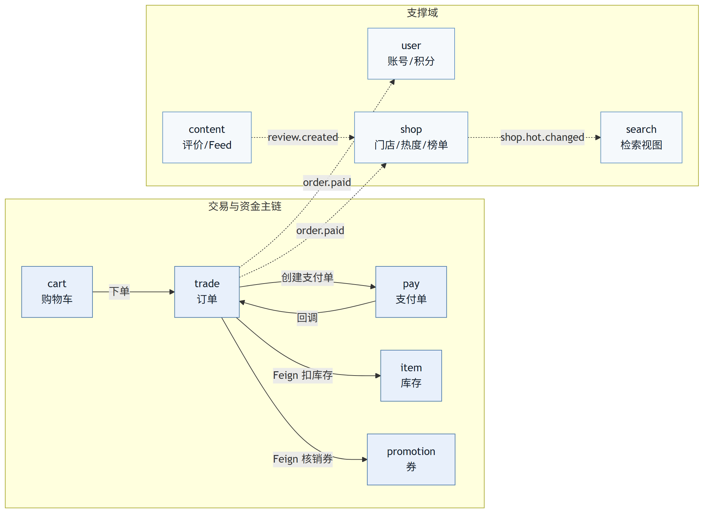

# 同城生活电商平台 · 架构设计

> **本文口径**：设计**为什么**这么做、边界在哪、代价是什么。实现细节以代码为准，
> 已知偏差以 [`已知偏差台账-2026-10-15.md`](已知偏差台账-2026-10-15.md) 为准。
>
> **一句话**：一个按领域拆分的同城生活电商后端——1 个网关 + 9 个业务域，
> 一服务一库，跨域只走 Feign 契约与领域事件，不跨库 JOIN。

---

## 0. 设计目标与约束

| 维度 | 目标 | 约束（决定取舍的东西） |
|---|---|---|
| 拆分 | 服务边界与组织结构、数据所有权对齐 | 单人开发，无法用人力弥补边界设计错误 |
| 一致性 | 资金与库存不允许出现中间态；其余允许延迟 | 不引入分布式事务框架做默认路径（性能代价已量化，见 §5.2） |
| 性能 | 读路径毫秒级、写路径可水平扩 | 压测与被测服务同机，绝对值不可与生产对标，只做同环境梯度对比 |
| 可运维 | 一条命令起全栈、一条命令验全量 | 单一宿主机资源有限（内存是硬约束） |
| 可验证 | 每条对外结论都有可复现判据 | 机器判据优先于文字承诺（`gates/`） |

---

## 1. 拆分原则：按领域拆，不是按功能拆

**拆分的三条判据**（缺一条就不拆）：

1. **业务能力内聚** —— 一个服务能独立回答一类业务问题，不是"一类技术动作"（缓存、搜索、鉴权都是技术手段，不是领域）；
2. **数据所有权独占** —— 只有它能写自己的表；别人要数据只能调接口或订阅事件；
3. **可独立部署演进** —— 单独重启它不会拖垮全站，单独升级它不需要全站联调。

**"分布式单体"的三个反例**（本项目坚决不做）：

- 多服务共享一个库、互相查表 —— 逻辑上还是单体，只是把进程拆开了；
- 服务之间用同步调用串成一条长链 —— 一个慢点拖垮整条链，等于把单体的耦合换了个位置；
- 一个业务动作要改三个服务的事务 —— 边界划错了，应该合并而不是加协调者。

**结论**：9 个业务域 + 1 个网关。网关不持库，只做路由、鉴权、限流与请求头治理。

---

## 2. 服务清单与数据归属（10 个服务，一服务一库）

| 服务 | 端口 | 独占库 | 边界说明 |
|---|---|---|---|
| llmall-gateway | 8080 | — | 统一入口；不持业务数据，不做业务判断 |
| llmall-user-service | 8084 | llmall-user | 账号与身份、地址、积分与流水 |
| llmall-shop-service | 8087 | llmall-shop | 门店、门店类型、热度、榜单、GEO |
| llmall-item-service | 8081 | llmall-item | 商品/套餐、SKU、库存与库存流水 |
| llmall-cart-service | 8082 | llmall-cart | 购物车（独立域，不参与交易事务） |
| llmall-trade-service | 8085 | llmall-trade | 订单、本地消息表、对账任务 |
| llmall-pay-service | 8086 | llmall-pay | 支付单、支付回调 |
| llmall-promotion-service | 8088 | llmall-promotion | 优惠券、秒杀券、核销记录 |
| llmall-content-service | 8089 | llmall-content | 评价/笔记、评论、点赞、关注、Feed |
| llmall-search-service | 8093 | llmall-search | 检索视图、热词、搜索历史 |
| （不拆）站内信 | — | — | **未实现**：通知可以后置到任意阶段，先拆出来只会多一个没人调用的服务 |

端口与职责的**唯一权威表**在 [`../README.md`](../README.md) §1.2，本文不维护第二份口径。

实线 = 同步调用（在用户请求的链路里）；虚线 = 异步事件（在链路之外补齐）。

---

## 3. 跨域数据：只走三种手段（不跨库 JOIN）

任何服务**不得直接访问别人的库**。跨域展示与联动只有三种手段：

| 手段 | 用在哪 | 代价 |
|---|---|---|
| **Feign 聚合** | 门店详情要展示套餐（商品域）、评价列表（内容域） | 同步依赖，下游抖动会传导；只为"当次请求必须要的数据"用它 |
| **冗余快照字段** | 下单时把商品名、单价、门店名快照进订单 | 数据会旧；但订单必须记录"成交时的事实"，旧是正确行为 |
| **事件构建本地视图表** | 检索域按热度维护自己的门店视图；内容域维护粉丝 Feed | 最终一致（秒级延迟）；换来读路径零跨域调用 |

判断规则：**当次请求必须准的用 Feign，展示用的用事件，交易事实的用快照。**

---

## 4. 公共层：llmall-common 与 llmall-api

两个模块不部署、不是服务，只是被所有服务依赖的库：

| 模块 | 放什么 | 为什么单独抽出来 |
|---|---|---|
| `llmall-common` | 统一响应体、全局异常、`UserContext`、鉴权常量、MQ 消息转换器、Feign 拦截器 | 让"鉴权透传""统一错误码"这类横切逻辑只有一份实现 |
| `llmall-api` | Feign 客户端接口 + DTO + 领域事件定义 + 降级工厂 | 服务间契约只有一处定义，改接口时编译期就能发现影响面 |

**版本口径随之统一**：父 pom 用 `dependencyManagement` 锁死整套版本（Spring Boot 2.7.18 /
Spring Cloud 2021.0.8 / Spring Cloud Alibaba 2021.0.6.2 / MyBatis-Plus 3.5.3.2），
子模块不写版本号——版本漂移是这类项目最常见的隐性事故源。

---

## 5. 核心链路的一致性设计

### 5.1 鉴权与身份透传

**只在网关验签**，下游靠可信请求头 + `ThreadLocal`，Feign 调用自动透传。

理由：验签逻辑集中一处、性能好、不会出现"某个服务忘了验签"；代价是**内网必须可信**，
所以入口**无条件剥离**客户端自带的 `user-info` 类请求头——这一条是踩过越权漏洞后补的。
下游再做一层 fail-closed：只有 `user-info` 与内部凭证**同时**具备才采信，否则按未登录处理。
完整时序见 [`../README.md`](../README.md) §2.1。

### 5.2 下单支付：分层一致性

| 环节 | 一致性要求 | 方案 | 为什么不用更重的方案 |
|---|---|---|---|
| 订单状态迁移 | 强（不能重复迁移） | 条件更新 `WHERE status = 旧值` | 唯一键 + 条件更新已足够，加锁只是优化 |
| 扣库存 / 核销券 | 强（不能有中间态） | 条件更新 + 库存流水；可选 Seata AT | AT 的代价已量化：`POST /orders` **+259%**、吞吐 **−21%**（[`P-03`](P-03-Seata-AT对照-2026-10-17.md)），因此**默认关** |
| 加积分 / 累加销量 / 更新检索视图 | 最终一致 | 本地消息表 + 重试 + 定时对账 | 这些动作允许延迟，放进全局事务只会拉长锁持有时间 |

**默认路径是一条"单库事务 + 消息表"的链路**：业务数据与消息在同一本地事务提交
（业务成功 ⇒ 消息必在），提交后投递，失败则指数退避重试，另有对账任务主动问下游"处理了吗"。
Seata AT 作为**可切换的强一致分支**保留：需要"券与库存不能有中间态"时打开，
且三个 `seata.enabled` 必须同进同退（只开 trade 会造成少卖）。

**幂等锚在数据库唯一键**，不在 Redis：生产侧（`message_log` 唯一键）、消费侧（消费记录唯一键）、
业务侧（业务唯一键）三层，绝不假设 MQ 不重复投递。

### 5.3 评价 → 门店热度 → 榜单

写路径用一条 SQL 原子更新评价数与平均分（**赋值顺序有坑**：`score` 的计算必须写在
`comments = comments + 1` 之前，否则平均分被系统性算低），重算热度后写 DB、更新 ZSet 榜单、
失效详情缓存，再发 `shop.hot.changed` 让检索域更新自己的视图。

读路径只读 ZSet 与缓存：**排序不走 DB**（Top-N 在 ZSet 里是毫秒级），也**不用 ES 做榜单**
（ES 适合多条件检索，不适合单一维度排序）。

---

## 6. 技术栈与版本口径

| 类别 | 选型 | 关键说明 |
|---|---|---|
| 运行时 | Java 11 + Spring Boot 2.7.18 | Lombok 与 JDK 22+ 的 javac 内部 API 不兼容，闸门在启动阶段就 fail-fast |
| 微服务 | Spring Cloud 2021.0.8 + Spring Cloud Alibaba 2021.0.6.2 | 三者必须成套对齐，单独动任何一个都会踩客户端/服务端版本倒挂 |
| 持久层 | MyBatis-Plus 3.5.3.2 + MySQL 8 | 不手写驱动版本，交给 Spring Boot 的依赖管理 |
| 缓存/榜单 | Redis 7 | 缓存三件套（穿透/击穿/雪崩）+ ZSet 榜单 + GEO 附近门店 + HLL 统计 UV |
| 消息 | RabbitMQ（+ 延迟消息插件 + 死信队列） | 领域事件、超时关单、消费失败兜底 |
| 检索 | Elasticsearch 7.17 + IK | 与 MySQL 读模型双引擎，`engine=auto` 优先 ES、不可用自动回落 |
| 事务 | Seata AT（**默认关**） | 见 §5.2 的对照数据 |

---

## 7. 可扩展性预判与已知风险

| 风险 | 现在的处理 | 真到那一步要做什么 |
|---|---|---|
| 热点门店写扩散 | 写路径一条 SQL 原子累加；热度分钟级重算 | 按 `shop_id` 分片或改增量聚合 |
| 大 V 粉丝写扩散 | Feed 推拉结合，粉丝数 > 1000 走拉模式 | 收件箱拆分 + 冷热分层 |
| 单库写入瓶颈 | 一服务一库，天然可拆 | 订单表按用户或时间分表，读写分离 |
| 同步依赖抖动 | 只为"当次必须准"的数据用 Feign；写调用禁用 Feign 重试 | 熔断降级（Sentinel 已在 5 个服务接入） |
| 单机资源上限 | 每服务 `-Xmx192m`、容器 `mem_limit 256m`，`core`/`full` 两种启动集 | 上多机 + 注册中心按机房分组 |

---

## 8. 明确不做的事

- **不做站内信**：没有用户量的系统做通知只是自娱自乐；
- **不做跨库 JOIN / 分布式查询引擎**：那等于把服务边界重新糊上；
- **不默认开启分布式事务**：代价已量化，收益只在失败回滚时兑现；
- **不做多租户与复杂权限模型**：本项目的"权限"只有"本人 / 他人"两种，加 RBAC 是过度设计。
