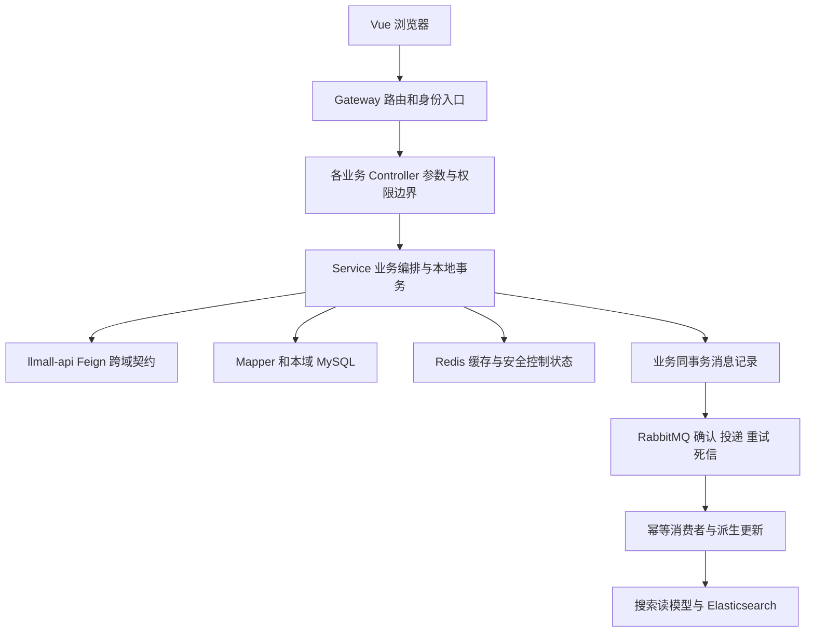

# llmall 项目完整分析（优化版）

更新日期：2026-10-30。对象为 `D:/dsh/llmall` 的优化代码及本批待交付改动，不是旧 Docker 镜像。面试讲法另见[项目面试手册](项目面试手册-优化版.md)。

## 1. 这个项目到底是什么

这是面向个人学习、简历展示和本机演示的**同城生活电商微服务项目**。它把商品购买和门店到店消费放在同一个业务场景：浏览门店/套餐、购物车、优惠券、订单、余额支付、门店员工核销、评价、关注和 Feed、搜索与热度榜。

工程组织为 **12 个 Maven 子模块：2 个共享库、1 个网关、9 个业务服务**；运行时是 10 个 Java 服务，不是“12 个微服务”。另有 Vue 前端、配置中心资料、SQL、容器编排、工程闸门和压测材料。复杂度属于**中等偏高的个人工程作品**：难点主要来自跨域调用、事务边界、重试、读模型和身份传播，而不是商品 CRUD 的数量。

适合演示接口开发、日志排错、SQL/连接池分析、缓存并发、业务幂等和异常恢复。不适合未经额外治理就直接承接真实资金、商户结算或商业短信业务。保留未实现边界不等于继续无限扩张功能。

### 技术栈与依赖口径

| 层面 | 当前选型与作用 |
|---|---|
| Java / 框架 | 源码目标 Java 11；Spring Boot 2.7.18、Spring Cloud 2021.0.8、Spring Cloud Alibaba 2021.0.6.2；本机验证使用 JDK 17 |
| 接口与调用 | Spring MVC、Spring Cloud Gateway、OpenFeign、OkHttp、Bean Validation、Knife4j/OpenAPI |
| 数据 | MySQL 8、InnoDB、MyBatis-Plus 3.5.3.2；HikariCP；金额使用分，数据库保存业务事实 |
| Redis | Spring Data Redis/Lettuce、Lua；令牌撤销/刷新、口令错误预算、热点缓存、限流/锁、Feed/ZSet、GEO、UV 等 |
| RabbitMQ | Spring AMQP、消息转换、业务事件、延迟关单；通用本地消息表、发送确认、重试、服务独立死信队列 |
| 搜索 | Elasticsearch 7.17 系列、MySQL 搜索读模型、增量事件和版本比较；非源业务权威库 |
| 治理 | Nacos 配置/发现、Sentinel、Actuator/Micrometer/Prometheus/Grafana；Seata 默认关闭，不能写成默认所有业务都走分布式事务 |
| 前端 | Vue 3、TypeScript、Vite、Pinia、Axios、Element Plus、json-bigint；Playwright 与 Node 测试 |
| 工程 | Maven 多模块、Docker Compose、PowerShell/Java 验证脚本、SQL 迁移、压测与独立数据库核对 |

版本来自父 POM 和前端依赖声明；声明使用范围符号不代表任何机器都安装相同版本。未完成一次全新联网 `npm ci`、全量依赖安全扫描或原始 Maven 依赖从零安装，不把本机缓存构建当成这些工作的证明。

## 2. 阅读范围与证据规则

本报告整合初始全项目审查、各批代码改造/交付记录，以及最终有界收尾。初始清单覆盖业务模块、父子 POM、配置、SQL、前端、脚本、闸门、文档和 benchmark；初始 710 文件包含二进制和生成数据，不能理解成每个字节都逐行审读。当前代码与文档持续增加，数量以本批 inventory 为准。图片、第三方词库/JAR、生成 SQL 的大量种子值不做逐值审计。

证据分为四种，不能混用：

1. **源码/回归证据**：代码分支与自动化测试，不代表已部署。
2. **HTTP/MySQL 等组件验证**：真实部分组件，其他依赖可有适配器，必须交代范围。
3. **当前构建隔离联调**：真实服务和私有基础设施，仍可能采用静态路由等测试配置，不等于完整生产环境。
4. **历史运行成绩**：历史源码/镜像/数据/参数的结果，不能直接转移到新版。

最终批后端默认回归 **375 项、54 个测试类，0 失败/错误/跳过**；显式真实 Rabbit/MySQL 集成另有 **1 个测试方法、6 个故障场景**。前端 21 项单测、类型检查和构建通过；改密浏览器夹具与真实后端浏览器联调通过。四份 POM 仅在隔离副本使用同版本本地 H2 JAR 作离线适配，未交付；沿用已有 node_modules，未声称干净依赖安装已验收。

最终隔离联调通过：9 个真实 Boot 进程、真实网关/Feign/私有 MySQL/Redis/Sentinel/Rabbit 和浏览器，完成改密、买券、带券下单/回放、支付、查询、越权拒绝及独立查库。配置/发现采用静态测试路由，未启动 Nacos 与 ES，不称全栈压测。对现有业务库没有执行 64/65/66；私有空表克隆上的成功不能跳过正式升级维护窗口与旧数据守卫。

## 3. 设计思路与模块边界

核心决策是按业务所有权拆服务，每个业务域独占数据库；跨域同步查询/命令走 Feign，延后处理的派生更新走 MQ。应用不能靠直接查别人的库省掉接口。升级脚本里的跨库守卫是维护期核对，不是运行时业务跨库 JOIN。

| 模块 | 职责、数据与主要依赖 |
|---|---|
| `llmall-common` | 异常/响应、身份上下文、JWT/内部凭据、缓存与线程装饰器、MQ/事务工具、Trace。被多个服务复用，改动影响范围大 |
| `llmall-api` | Feign 契约、DTO、事件、超时/兜底等调用配置；不存业务数据，不应吸收业务实现 |
| `llmall-gateway` | 路由、JWT/刷新、剥离伪造头、故障分支、跨域；依赖 Redis、JWT 密钥、Nacos 路由和下游服务 |
| `llmall-user-service` | 用户、地址、登录/验证码、令牌撤销、支付口令、余额与流水、积分/签到；接收内部余额操作和订单事件 |
| `llmall-shop-service` | 门店/类型、员工与角色、收藏、热度、GEO/UV、热点详情缓存；为交易核销提供员工权限判定，向搜索传播门店变化 |
| `llmall-item-service` | 商品/套餐、库存及库存业务记录；对交易提供批量商品查询、扣减和回补，消费销售类事件 |
| `llmall-cart-service` | 用户购物车；查询商品资料，消费清理购物车事件；不代替库存和订单权威判断 |
| `llmall-trade-service` | 订单/明细、输入边界、客户端幂等、券绑定、支付后状态、关单/退款补偿、核销；依赖商品、用户地址、营销、支付、门店 |
| `llmall-pay-service` | 支付单、持久支付尝试、余额支付编排、取消/恢复、成功通知；依赖交易权威订单、营销券绑定、用户余额接口、MQ |
| `llmall-promotion-service` | 券模板/实例、普通购券持久尝试、券绑定与取消墓碑、免费秒杀演示；余额归用户服务。旧收费秒杀新请求已拒绝 |
| `llmall-content-service` | 笔记/评价、点赞、关注、Feed 收件箱与推拉读取；依赖用户展示资料和门店事件，不能以用户请求参数冒充作者身份 |
| `llmall-search-service` | 搜索读模型、ES 索引、查询/建议/热词/历史、空索引探测和受控维护；消费业务事件，不能反向成为门店的权威库 |
| `frontend` | 浏览/登录、购物车、结算/订单/个人中心、门店与内容页面；只调用网关。保存会话但不保存支付口令；超大 ID 保留字符串 |

### 分层

Controller 负责输入、身份和接口级授权；Service 编排业务与本地事务；Mapper 保证条件更新、唯一键与锁语义。Redis 承担低延迟控制/缓存，MySQL 承担持久业务事实，MQ 承担异步传播，ES 承担检索。它们各自解决不同问题，不能因用了 Redis 锁就取消 MySQL 幂等约束。

## 4. 三条核心链路

### A. 登录、撤销与修改支付口令

1. 浏览器提交用户名/密码到网关公开认证入口；用户域执行锁定检查、同成本密码比对、账号状态检查。
2. 用户域用 BCrypt 校验登录口令，签发 access/refresh；refresh 的可用身份存在 Redis 白名单，JWT 由网关与用户服务共享匹配密钥。
3. 网关剥离外部伪造的身份/内部凭据头，验 access、黑名单和用户失效水位，认证通过后注入可信身份。
4. 用户在个人中心输入原支付口令、新口令和绑定手机场景验证码。后端先做频控与验证码消费，再验旧口令，更新 BCrypt 哈希。
5. 提交后撤销该用户旧会话；前端清空 token/user 并回登录页。原 access 在水位规则下拒绝，refresh 也不能继续换新。
6. Redis 故障时受保护资源与续签返回服务暂不可用，不当作普通登录过期；支持匿名的公开读去掉身份继续。

登录口令和支付口令是两列、两种用途；两种内部凭据也不同：网关身份凭据不等于资金/内部命令凭据。支付口令预算为**连续每 5 次错误锁 5 分钟，解锁重新计数**，不增加多级长期封禁。验证码有独立场景/频控策略，不能把两个计数机制混为一谈。

### B. 普通买券、下单与余额支付

1. 普通付费购券以用户+requestId 识别同一请求。营销域先持久化购买尝试，调用用户余额域使用稳定业务键；发券失败/不确定进入既有取消与恢复流程，查询接口返回请求当前结果。
2. 下单先复制/校验输入，拒绝重复 SKU、数量/金额越界、跨门店或混履约；价格与券面额由服务端获取，不能接受客户端报价。单店单履约是主动缩小业务范围，不做自动拆单。
3. 交易域获取商品、计算分金额，写订单/明细及本地消息记录；用户+clientToken 唯一键支持同参数回放，异参数复用令牌拒绝。当前库存远程操作仍有创建失败窗口，见后面的明确边界。
4. 付款申请与实际付款都重新核对权威订单 ID、用户、状态、金额；带券订单还要确认该券已绑定这张订单，查不到就拒绝扣款。
5. 支付域短事务锁支付单并创建持久尝试；**远程余额扣款在本地支付事务外**执行。用户域按稳定 payment key、行锁与余额流水裁决重复扣款/取消先后。
6. 成功回本地短事务，记录尝试成功与支付单结果；成功通知经专用确认及恢复扫描补发。交易消费后标记订单支付，再记录订单已支付派生事件。
7. 购物车清理、积分/销量等异步处理。通用消息仅 ACK 且无 return 才记 SENT；超时/拒收/断链仍可重试。DONE 不被迟到的发送结果覆盖；消费端仍须幂等。
8. 失败先记录取消意图，再调用余额取消；无法确认则保留待恢复状态，不用超时推断“没扣钱”。恢复扫描推进既有协议；成功提交丢失确认时禁止误退。

### C. 门店读链路、评价与搜索派生

1. 门店详情走热点缓存；热值直接返回。过期可用旧值并安排有界重建，空值短缓存应对不存在的数据。
2. 重建者持有 token；写后失效会撤销旧重建发布资格，避免慢查询把旧数据重新填回。Redis 故障时只允许有限数据库回源，超额明确繁忙。
3. 评价等业务事件更新门店热度；本域事实提交后再向搜索传播完整读模型事件，回滚不发送。
4. 搜索 MySQL 读模型在锁内比较事件版本；ES 单条/批量写采用条件脚本防旧值覆盖新值，时间精度依赖 66 迁移。
5. 搜索正常查询不必每次额外 count。空结果需要区分“没有命中”和“索引未初始化”；用有 TTL 的非空证据和单飞探测减少额外请求，不能缓存成全局永久结论。
6. ES 发布仍有 best-effort 窗口；这是搜索派生数据的边界，不宣传全站强一致。需要时通过受控重建/对账修复。

## 5. 六维评分

按个人演示/实习岗位工程作品评分；9–10 分需要更长运行与更完整故障证据。分数是审查判断，不是测试覆盖率或安全认证。重点实现达到 7–8 分，不代表模块的每个边缘接口都达到相同程度。

| 模块/范围 | 代码质量 | 异常处理 | 安全性 | 性能 | 可维护性 | 一致性 |
|---|---:|---:|---:|---:|---:|---:|
| common | 7.5 | 8 | 7.5 | 7.5 | 7 | 8 |
| api | 8 | 7.5 | 7.5 | 7 | 7.5 | 7 |
| gateway | 7.5 | 8 | 8 | 7 | 7 | 7 |
| user | 7 | 7.5 | 7.5 | 7 | 7 | 7.5 |
| shop（缓存/员工为重点） | 7.5 | 8 | 8 | 8 | 7 | 7.5 |
| item | 7 | 7 | 7 | 7 | 7 | 6.5 |
| cart | 7 | 6.5 | 7 | 7 | 7 | 6.5 |
| trade | 7 | 7.5 | 7.5 | 7 | 6.5 | 6.5 |
| pay（余额尝试为重点） | 8 | 8 | 8 | 7.5 | 7.5 | 8 |
| promotion | 7 | 7.5 | 7 | 7 | 6.5 | 7 |
| content | 7 | 7 | 7 | 7.5 | 7 | 7 |
| search | 7.5 | 7.5 | 7.5 | 8 | 7 | 7 |
| frontend | 7 | 7.5 | 7 | 7 | 7 | 6.5 |
| 配置/部署/依赖 | 6.5 | 6.5 | 6.5 | 7 | 6.5 | 6.5 |
| 文档/脚本/验证 | 7 | 7 | 7 | 7 | 7 | 7 |

整体约 7 分，重点读链路、余额支付尝试、鉴权故障与员工权限更强。交易一致性仍受完整库存创建协议缺失影响，不能用支付模块的 8 分抵消。配置与部署还存在可复现安装、默认值、Redis 运行保护等短板，不为凑分改成生产级。

## 6. 已解决的主要问题及证据

| 原问题/类型 | 主要文件（模块内相对路径） | 最终改动与证据 |
|---|---|---|
| 普通购券重试可能重复收费/误退款 | promotion `service/impl/VoucherPurchaseStore.java`、`VoucherPurchaseCoordinator.java`；user 余额操作 | 持久尝试、稳定键和取消裁决；64/65 协议，异常回归及私有 SQL 证据，旧收费秒杀另行停收 |
| 支付跨服务结果不确定 | pay `service/impl/BalancePaymentCoordinator.java`、`PaymentAttemptStore.java` | 短事务、事务外 RPC、持久恢复、成功不误退；HTTP/MySQL 100 并发组件证据，非生产资金证明 |
| 下单混店/重复 SKU/金额溢出 | trade `support/OrderInputPolicy.java` | 副作用前拒绝，long 中间值和金额上限，同店/同履约边界，失败回归 |
| 带券支付未确认绑定/错订单响应 | pay `support/CouponPaymentEligibility.java`、支付申请/实际入口 | ID/归属/状态/金额双入口检查，券绑定查不到就拒绝；19 项专项用例 |
| 发送返回即记 SENT | common `mq/AbstractMessageLogService.java`、`ConfirmedMessagePublisher.java`、`config/MqConfig.java` | ACK+无 return；后台有界 2 线程/64 队列；独立短事务落发送状态，DONE 防覆盖；真实 Rabbit/MySQL 故障验证 |
| 死信失败仍确认原消息/跨服务广播 | common `config/MqDeadLetterConfig.java`、`mq/DeadLetterPublisher.java` | 按所属服务队列精确路由；转发失败抛重入队异常，保留原消息；恢复路由后确认成功且其他服务队列为空 |
| Redis 异常导致鉴权误判 | gateway `filters/AuthGlobalFilter.java` 及鉴权依赖逻辑 | 受保护/续签 503、公开匿名、失效水位校验；故障回归。不是 Redis 故障时无条件放行 |
| 最后 OWNER 并发撤销 | shop `service/impl/ShopStaffServiceImpl.java`、Mapper | 锁同店父行并使用当前读，重新检查操作者/OWNER；6 项真实 MySQL 验证 |
| 热点旧值回填与无界回源 | shop `cache/ShopDetailCache.java`、`ShopCacheFallback.java`；common 缓存实现 | token 发布栅栏、失效撤销、有界池与回源；真实时序及 6000 HTTP 热读证据 |
| 搜索额外请求和旧事件覆盖 | search `support/EmptyIndexFallbackProbe.java`、查询/增量服务 | 单飞探测、读模型/ES 防旧写；24000 请求、额外 count 5991→0；66 毫秒迁移与时序验证 |
| Feed 翻页边界/hasMore | content Feed 查询/VO、frontend Feed | v2 统一游标，末页判断与重复边界回归，真实 MySQL 验证；不是动态数据集全局快照 |
| 支付口令只有提示没有入口 | frontend `components/PayPasswordDialog.vue`、`views/Profile.vue`、`Checkout.vue` | 复用后端场景验证码/改密 API，防重复、倒计时、校验、清理敏感字段、改后重新登录；浏览器验证 |
| 危险清理/旧静态服务 | `demo.ps1`、旧清理 SQL/脚本、`scripts/StaticServer.java` | 破坏性入口停用；StaticServer 在监听前失败，推荐正常前端工具；无真实清库 |
| 线程上下文/JWT 初始化 | common 装饰器、`scripts/gen-jks.ps1` | 执行后恢复原上下文；共享 JKS、指纹检查、拒绝错配，已有回归证据 |

## 7. 保留问题、优先级与落地方案

这里是剩余工程成本，不把本次有界优化写成消灭所有缺陷。优先级按影响和启用前提排序；“启用收费秒杀前高”不代表当前停用状态必须再造整套系统。

| 优先级 | 模块/文件与类型 | 具体问题/影响 | 可落地方案与验收 |
|---|---|---|---|
| 高（真实订单上线前） | trade `OrderServiceImpl.doCreateOrder`、item 库存接口；一致性 | 远程扣库存与本地订单提交仍不是原子操作；崩溃/回包未知下的完整创建恢复未实现 | 独立立项持久创建尝试、库存预留/确认/取消及取消先到墓碑；故障注入证明最终不多扣/不漏还。本次不增加完整 SAGA |
| 高（恢复收费秒杀前） | promotion 秒杀入口、Lua 与 MQ；恢复 | 免费演示预扣 Redis→MQ→MySQL 仍有窗口；旧收费入口已拒绝新请求 | 保持收费关闭；真开放前增加持久预留与账实对账，验证 MQ 不可用、回包丢失、消费者崩溃；不能仅靠 Lua 宣称全链路不超卖 |
| 高（部署前） | `docker/redis/entrypoint.sh`、Compose；安全状态持久性 | 原默认 allkeys-lru、关闭 AOF/RDB；驱逐/重启可能丢失撤销与锁定控制状态；改密后的 Redis 撤销写入仍为 best-effort，写失败不能保证旧会话立即失效；同容器哨兵不等于 HA | 评估并配置持久卷+AOF everysec+noeviction，监控容量；缓存和安全状态后续可分实例。本批私有夹具验证此组合，不悄悄改现有运行容器；AOF 仍有故障丢失窗口。若需硬性改密撤销，另加持久撤销版本/失败恢复，不能只看正常改密通过 |
| 高（已有数据升级前） | `sql/merged/64…`、`65…`、`66…`；迁移 | 多服务协议/旧账守卫、毫秒精度存在发布顺序要求 | 维护窗口停相关旧写入、备份、核对旧 UNCERTAIN/扣款、按顺序执行；禁止 --force；私有成功不代表业务已升级 |
| 中 | search 增量提交后 ES 发布；一致性 | MySQL 已提交而 ES 写失败仍可能不收敛 | 需要更高可靠性时增加持久索引待办、校验/受控重建；重放旧/新事件及失败后修复。当前不承诺自动必收敛 |
| 中 | search 事件源版本生成；一致性 | 毫秒时间、bizId 不是严格全局因果版本，同毫秒和时钟回拨仍有边界 | 若业务需要严格顺序，用每实体数据库版本/源端单调序列；不要误用跨机器时间戳作全序 |
| 中 | gateway `router/DynamicRouteLoader.java`；可用性 | 全量删后写、异步订阅缺少完整原子切换/错误处理 | 后续保存成功路由快照，校验后更新、处理 save/delete 错误；用坏配置和更新中请求验证；静态测试路由不覆盖 Nacos 热更新 |
| 中 | user 非 local `SmsCodeSender`、弱账号恢复；业务完整性 | 非本地短信未接厂商；弱口令超期恢复不是完整产品流程 | 演示明确使用 local 强登录账号；上线前接通短信/用户恢复及审计，禁止生产打印验证码 |
| 中 | frontend `views/Orders.vue`、结算恢复；体验/状态 | 后台能恢复不等于前台能随时继续付款；刷新/响应丢失的统一收银台体验未完整实现 | 需要时增加仅未付且可付款订单的继续支付入口与状态查询，复用支付单，不由前端猜扣款结果 |
| 中 | 全项目本地/部署配置；安全/依赖 | 演示默认凭据、宽跨域、内部共享凭据、旧框架组合仍需生产治理 | 用环境秘密、收紧入口/跨域、独立证书管理；固定可复现依赖，单独评估框架升级，不在个人项目中临时全面 Boot3 迁移 |
| 中 | common `retryPending`、任务调度；性能 | 扫描逐条等待有界确认，Broker 故障时一批可能较慢；重试可重复投递 | 按已测资源限制批量、监控待办年龄/失败数；需要吞吐再分区/租约。不能把 return 值改成“排队数”伪装已发送成功 |
| 低 | common `DeadLetterPublisher` 四参数兼容重载；维护 | 旧 `<原队列>.dead` 路由与新精确服务绑定不同；当前生产 recoverer 已用五参数，无现有调用受影响 | 后续弃用旧重载或强制显式目的地；不要声称仅保留签名就等于行为完全兼容 |
| 低 | 大 Service、旧说明/注释、脚本；可维护性 | 个别类职责较多，部分历史注释仍有过强措辞，README 旧成绩易与新版混淆 | 按下一次功能修改就近抽取纯策略，删重复解释、补不变量；历史数字带版本/范围，逐条链接新报告。避免为短代码过度分层 |

## 8. 性能、安全与规范的结论

性能方面，最有价值的是定位排队/SQL/RPC的原因，降低额外工作，再看实际测量。不能把一项单测、一次热读或 SQL 数为零解释成全站容量。历史支付申请 AVG 1083→360ms、P99 2374→620ms 是 SQL 合并与连接池调整的累计产出，不是单次调池的独立收益。

安全方面，网关身份、服务凭据、资源归属、密码错误预算和资金幂等形成多道具体检查；Redis 控制状态丢失、共享凭据泄露、直接暴露下游端口仍是运行层边界。拒绝危险功能比保留一个未经验证的收费入口更适合当前项目。

规范方面，优先让代码明确表达不变量：副作用之前验证；资金键稳定；状态未知保留；事务短；重试可重复；线程池和等待有界；finally 恢复上下文；不在日志/URL/持久字段保存口令；前端与后端校验各自承担职责。注释应解释“为什么/边界”，避免重复翻译代码和绝对承诺。没有为每个低影响改动机械添加镜像测试。

最终交付与运行细节见[本批收尾验证](最终收尾验证-20261030.md)。本报告与面试手册是两个独立文件；简历文件没有随本次收尾自动重排。
