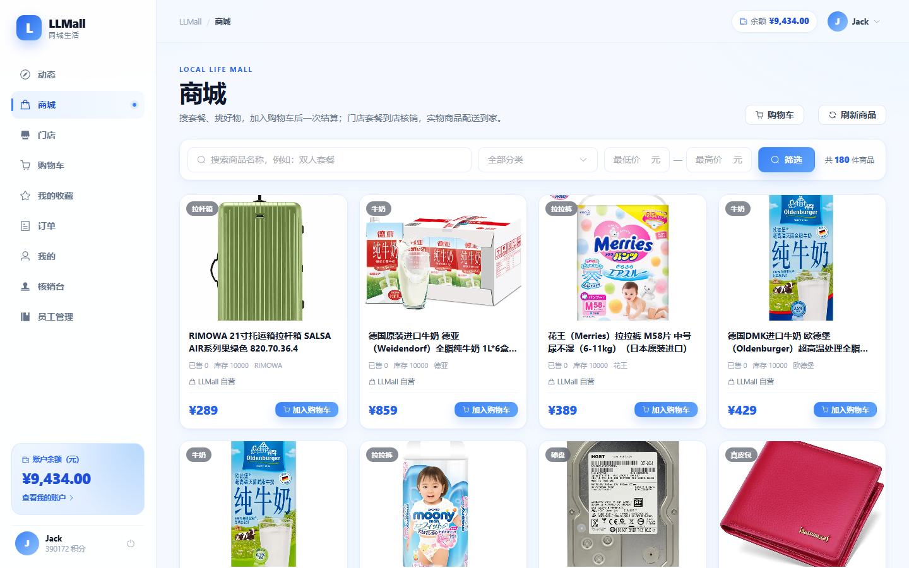
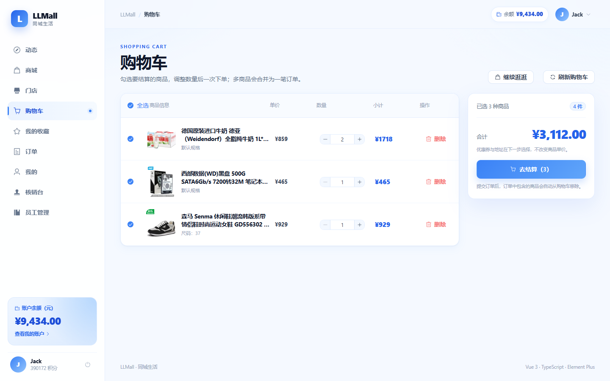
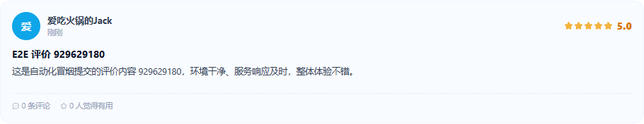
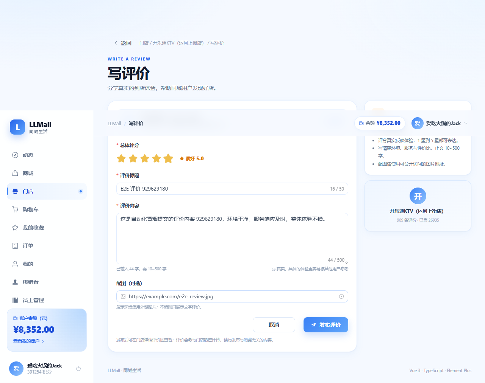
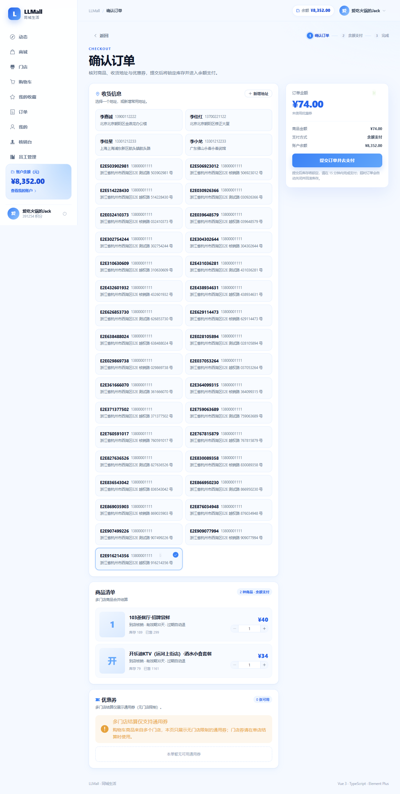
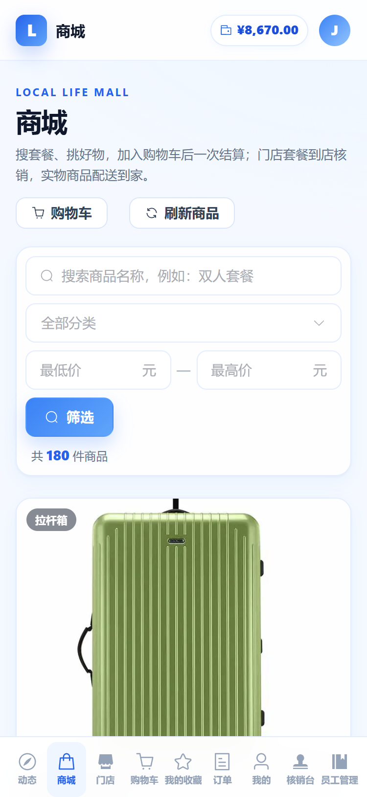
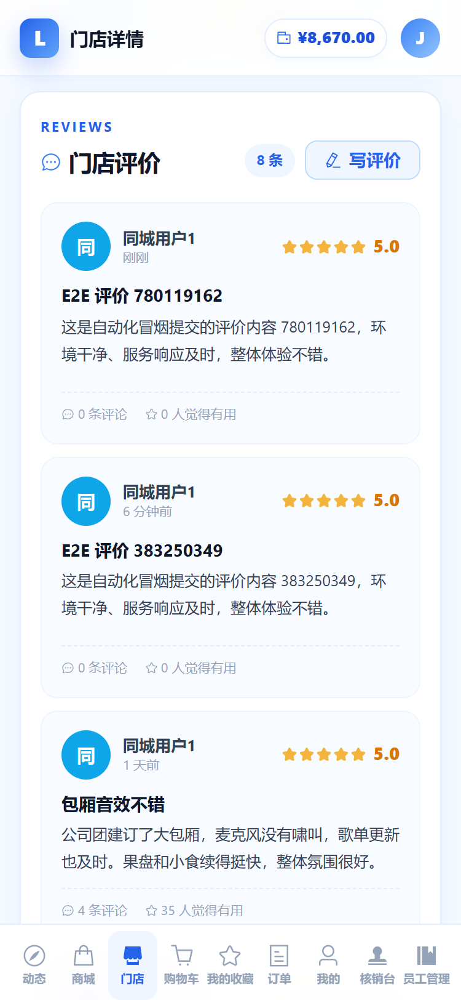

# LLMall 前端 · 同城生活

Vue 3 + TypeScript + Vite + Pinia + Vue Router 4 + Element Plus + Axios 的浅蓝主题企业级演示前端。

旧版单文件演示台（`index.html` + `theme.css`）已原样保留在 [`legacy-demo/`](./legacy-demo/)，不再参与构建。

## 快速开始

```bash
cd frontend
npm install
npm run dev        # http://localhost:5173
```

开发服务器把 `/api` 代理到 `http://localhost:8080`，并去掉 `/api` 前缀（与网关路由一致）。
如果网关不在默认地址，启动前设置 `LLMALL_API_TARGET`：

```bash
LLMALL_API_TARGET=http://192.168.1.10:8080 npm run dev
```

生产构建与本地预览：

```bash
npm run build      # vue-tsc -b && vite build，产物在 dist/
npm run preview    # http://localhost:4173，同样代理 /api
```

演示账号：**Jack / 123456**；演示支付口令：**888888**（与登录密码不同）。

## 启动与联调

### 1. 前置条件

- Node.js **20.19+**（建议 22.x）与 npm 10+
- 后端网关可访问：默认 `http://localhost:8080`
- 至少启动网关与用到的业务服务；本仓库 Docker 环境的网关服务名为 `gateway`

### 2. 安装与启动

```bash
cd frontend
npm install
npm run dev
```

打开 `http://localhost:5173`，使用演示账号登录：

| 项目 | 值 |
| --- | --- |
| 登录账号 | `Jack` |
| 登录密码 | `123456` |
| 支付口令 | `888888`（与登录密码不同，收银台/付费券会用到） |

### 3. `/api` 代理

开发服务器与 `vite preview` 都会把 `/api` 代理到 `http://localhost:8080`，并去掉 `/api` 前缀：

```text
浏览器 /api/users/login  ->  Vite proxy  ->  http://localhost:8080/users/login
```

网关不在默认地址时，用 `LLMALL_API_TARGET` 覆盖：

```bash
LLMALL_API_TARGET=http://192.168.1.10:8080 npm run dev
```

### 4. 鉴权头说明（VITE_AUTH_SCHEME）

当前仓库网关按**裸 JWT**读取 `authorization`（不剥离 `Bearer ` 前缀），因此前端默认发送裸 token：

```bash
# 默认行为，等价于 VITE_AUTH_SCHEME=raw
npm run dev
```

如果网关后续升级为标准的 `Bearer <token>` 方案，无需改代码：

```bash
VITE_AUTH_SCHEME=bearer npm run dev
VITE_AUTH_SCHEME=bearer npm run build
```

> 401 处理：并发请求共享同一个刷新 Promise，只调用一次 `POST /users/token/refresh`
> （`X-Refresh-Token` 请求头），成功后就地重放原请求；失败则清空 localStorage 并跳转 `/login`。

### 5. 构建、预览与 Docker

```bash
npm run build      # vue-tsc -b && vite build，产物在 dist/
npm run preview    # http://localhost:4173，同样代理 /api
```

容器构建（多阶段 Node 22 构建 + Nginx 托管，不修改 deploy 下的 compose）：

```bash
# 在仓库根目录（llmall/）执行
docker build -f frontend/Dockerfile -t llmall-frontend:1.0.0 frontend

# 运行时需接入 gateway 所在的 Docker 网络（本项目 external network 为 local-life）
docker run --rm -p 8081:80 --network local-life llmall-frontend:1.0.0
```

容器内 Nginx 的 `/api/` 反向代理到 `http://gateway:8080/`，与开发环境的 `/api` 语义一致；
因此前端容器必须和 `gateway` 处于同一 Docker 网络。

## 目录结构

```
frontend/
├─ index.html
├─ vite.config.ts          # 5173 dev server + /api 代理
├─ Dockerfile              # Node 22 构建 + Nginx 运行
├─ nginx.conf              # SPA 回退 + /api 反代 gateway:8080
├─ .dockerignore
├─ tsconfig*.json
├─ src/
│  ├─ main.ts              # Element Plus 全量引入 + 中文 locale
│  ├─ App.vue
│  ├─ style.css            # 设计变量、Element Plus 主题覆盖、响应式
│  ├─ api/
│  │  ├─ http.ts           # axios 实例、鉴权头、401 单次刷新队列
│  │  ├─ modules.ts        # 按业务域拆分的接口
│  │  └─ types.ts          # 后端 VO/DTO 对应的简单接口
│  ├─ stores/auth.ts       # 登录态 + 用户信息（localStorage + Pinia）
│  ├─ router/index.ts      # 路由与登录守卫
│  ├─ layouts/AppLayout.vue
│  ├─ components/          # PageHeader / StateBlock / ShopCard / FeedCard / VoucherCard
│  └─ views/
│     ├─ Login.vue
│     ├─ Feed.vue
│     ├─ Mall.vue          # 商城：关键词/分类/价格区间/分页 + 加购
│     ├─ ItemDetail.vue    # 商品详情：加购 / 立即购买 / 所属门店
│     ├─ Cart.vue          # 购物车：选品、改数量、删除、合计、去结算
│     ├─ Favorites.vue     # 我的收藏：取消收藏 / 进门店
│     ├─ Shops.vue         # 门店列表（/shops/page 分页）
│     ├─ ShopDetail.vue    # 门店详情 + 收藏 + 评价（头像/昵称/评分/内容）
│     ├─ ReviewCreate.vue  # 写评价：评分/标题/正文/图片 URL
│     ├─ Checkout.vue      # 结算：立即购买 / 购物车多商品 / 多门店通用券提示
│     ├─ Orders.vue        # 顾客订单：核销码 + 到店出示（无核销按钮）
│     ├─ StaffVerify.vue   # 员工核销台（/staff/verify，任意员工角色）
│     ├─ StaffManage.vue   # 员工管理（/staff/manage，仅 OWNER/MANAGER）
│     └─ Profile.vue
├─ e2e/                    # Playwright 冒烟（9 条：地址 / 核销 / 付费券 / Rose 403 / 商城 / 收藏 /
│                          #   评价 / 写评价 / 多门店券降级）
├─ scripts/mobile-smoke.mjs # 375×812 移动端冒烟（npm run test:mobile）
├─ playwright.config.ts
└─ legacy-demo/            # 旧单文件演示台，仅留档
```

## 页面与接口

| 页面 | 接口 |
| --- | --- |
| 登录 | `POST /users/login` |
| 关注动态 | `GET /follows/feed/v2?size=10`，复合游标 `li/ct/ci/ai` |
| 商城 | `GET /items/page?pageNo=&pageSize=&key=&category=&minPrice=&maxPrice=`、`GET /items/categories`、`GET /shops/batch?ids=` |
| 商品详情 | `GET /items/{id}`、`GET /shops/{id}` |
| 购物车 | `GET /carts`、`POST /carts`、`PUT /carts`（只改 num）、`DELETE /carts/{id}` |
| 我的收藏 | `GET /shops/my/favorites`、`DELETE /shops/{id}/favorite` |
| 门店列表 | `GET /shops/page?page=&size=&keyword=` |
| 门店详情 | `GET /shops/{id}`、`GET /items/shop/{shopId}`、`GET /vouchers/list?shopId=`、`GET /blogs/shop/{shopId}?page=&size=`（返回 BlogVO：含 `nickname/icon`）、`GET/POST/DELETE /shops/{id}/favorite` |
| 写评价 | `POST /blogs`（`shopId/title/content/score/images`） |
| 领券 | `POST /vouchers/{id}/receive`（付费券在请求体带 `pw`） |
| 结算/下单 | `GET /addresses`、`POST /orders`（`details` 支持多行）、`GET /orders/{id}` |
| 支付 | `POST /pay-orders`、`POST /pay-orders/{id}` |
| 订单（顾客） | `GET /orders`、`GET /orders/{id}`、`PUT /orders/{id}/cancel` |
| 核销台（员工） | `GET /shops/my/staff`（判断员工身份/任职门店）、`POST /orders/verify` |
| 员工管理（店主/店长） | `GET /shops/{shopId}/staff`、`POST /shops/{shopId}/staff`、`PUT /shops/{shopId}/staff/{userId}`、`DELETE /shops/{shopId}/staff/{userId}` |
| 我的 | `GET /users/me`、`GET /vouchers/my`、`POST /users/logout` |

> **核销语义**：核销是门店员工的动作。顾客侧只展示核销码并提示"到店出示给店员"，没有核销按钮；
> 核销动作在 `/staff/verify` 核销台完成，入口对任意员工角色展示。
> **管理语义**：`/staff/manage` 入口只对 OWNER/MANAGER 展示，可增删员工、改角色；
> 最后一个 OWNER 不可删/降级，店长不能授予/撤销 OWNER。
> 前端判断只是 UX，后端对非本店员工/无管理权者始终返回 403。

字段口径以后端代码为准：

- 订单侧余额支付是 `paymentType=3`；支付侧是 `PayType.BALANCE=5`，两个枚举不同。
- `PayApplyDTO` 需要 `bizOrderNo / amount / payChannelCode / payType / orderInfo`。
- `PayOrderFormDTO` 只需 `pw`，支付单 id 走路径。
- 核销 `OrderVerifyDTO` 需要 `verifyCode + shopId`。
- 所有 JSON 响应统一由 `json-bigint` 解析（`storeAsString: true`）：超过 JS 安全整数范围的 Long id 会自动变成字符串。
  即使后端个别接口把 19 位雪花号作为 JSON number 返回，也不会被 `JSON.parse` 舍入；`types.ts` 里所有 id 字段均为 `string`。

## 鉴权说明（与常见示例的差异）

`http.ts` 默认在 `authorization` 中发送**裸 JWT**，而不是 `Bearer <token>`。
原因：当前仓库的网关 `AuthGlobalFilter#firstHeader` 按裸 JWT 读取，未剥离 `Bearer ` 前缀；实测发送 `Bearer` 会得到 401 `invalid-token`，后端文档与旧演示台也都使用裸 token。

如果网关后续升级为标准的 `Bearer` 方案，不需要改代码，构建时设置即可：

```bash
VITE_AUTH_SCHEME=bearer npm run build
```

401 处理：所有并发 401 共享一个刷新 Promise，只调用一次
`POST /users/token/refresh`（`X-Refresh-Token` 请求头），刷新成功后重放原请求；
刷新失败清空本地登录态并跳转 `/login`。

## 交付验收

```bash
cd frontend
npm install
npm run build
npm run dev
curl -I http://localhost:5173

# Playwright 冒烟（9 条：地址 / 核销 / 付费券 / Rose 403 / 商城加购 / 收藏 /
#   评价 / 写评价 / 多门店券降级）
npm run test:e2e

# 375×812 移动端冒烟（登录/商城/购物车/门店详情/评价/写评价页），输出截图到 docs/images/
npm run test:mobile
```

- 页面：登录 / 关注动态 / 商城 `/mall` / 商品详情 `/item/:id` / 购物车 `/cart` /
  我的收藏 `/favorites` / 门店列表 / 门店详情 `/shops/:id` / 写评价 `/shops/:id/review` /
  结算收银台 / 订单 / 核销台 `/staff/verify` / 员工管理 `/staff/manage`（仅 OWNER/MANAGER）/ 我的。
- 评价作者资料：后端 `POST /internal/users/profiles` 批量返回昵称/头像，内容域 `BlogVO` 回填；
  前端昵称为空回退「同城用户{id}」，头像为空用首字 + 稳定背景色。
- 多门店结算：只展示 `shopId` 为空的通用券，并提示「多门店结算仅支持通用券」。
- 图标：统一使用 `@element-plus/icons-vue`，尺寸 14~18px，无外部图片。
- 商城/购物车/收藏/评价的实现细节（接口、幂等、种子数据、验收口径）见
  [`../docs/商城-购物车-收藏与评价.md`](../docs/商城-购物车-收藏与评价.md)。

- `npm run test:e2e` 用本机 Chrome（`channel: 'chrome'`），`baseURL=http://localhost:5173`，
  `testDir=e2e`，`webServer` 在 dev server 未启动时自动执行 `npm run dev`（已启动则复用）。
- 前置：网关 8080 与 MySQL/Redis/Nacos/RabbitMQ 已运行、演示数据已导入（`sql/merged/README.md`）；
  收藏/评价用例还需要 `sql/merged/34-shop-favorite.sql`、`35-review-seed.sql` 已执行。
- 用例可重复执行：地址/订单每轮新建；付费券"一人一张"，已领取时断言"已领取"而不重复扣款；
  商城用例开头通过接口清空购物车；收藏用例开头通过接口删除历史收藏（两个接口本身幂等）；
  写评价用例用唯一标题/内容定位新评价，不依赖列表顺序。
- 移动端脚本用 `elementFromPoint` 检查关键按钮是否被 sticky 顶栏/底部导航遮盖，并逐页断言
  `scrollWidth <= clientWidth`；脚本只清理自己加购的商品，不影响其他购物车行。









构建产物约 1.7 MB（未压缩），Element Plus 全量引入后主 vendor chunk 约 823 KB；
已在 1440px 与 375×812 下检查布局与主要交互（移动端由 Playwright 脚本复跑）。
